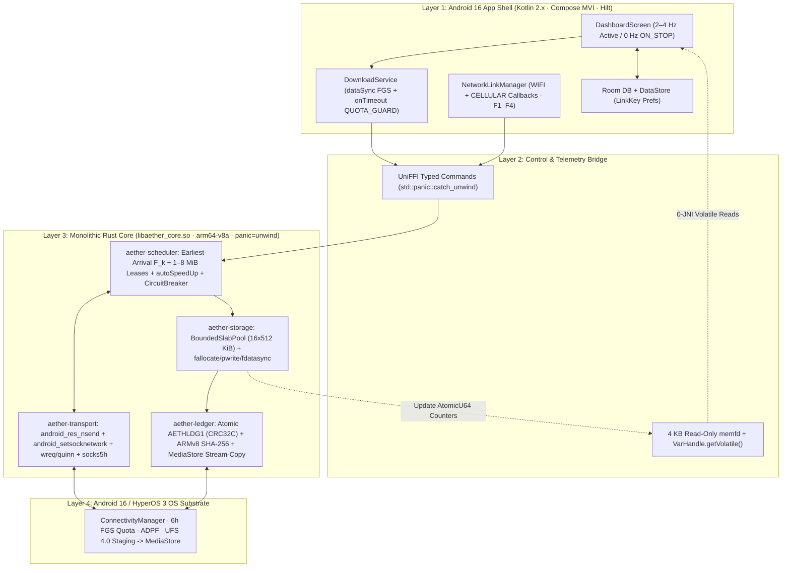
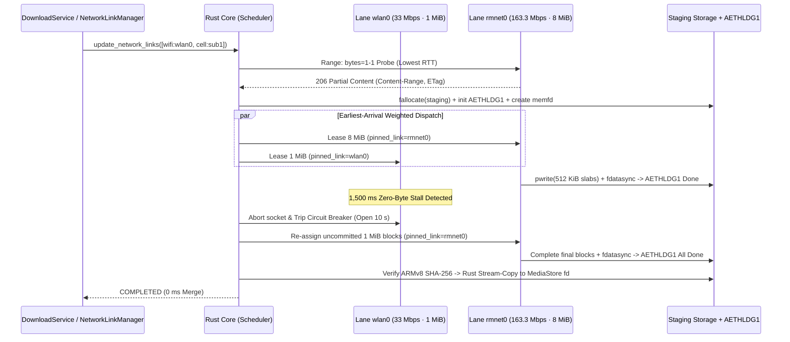
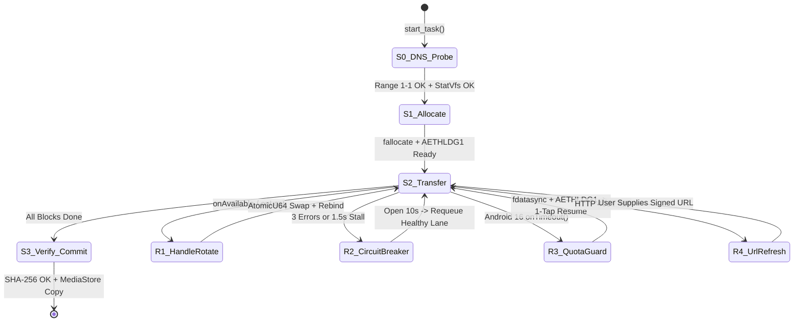

# Project AetherIO Omega v7.1 — Complete Android Downloader Engineering Package

**Role & Governance:** Principal Software Architect, Android Engineering Lead & Technical Orchestrator  
**Scope:** Standalone Android Download Engine & Application (`android-app` + `libaether_core.so`, `arm64-v8a`)  
**Target Platform:** Android 15 / Android 16 (API 35/36, HyperOS 3), Min SDK 31  
**Reference Verification Hardware:** Xiaomi Redmi Pad Pro 5G (`wlan0` 33.0 Mbps + `rmnet0` 163.3 Mbps)

---

## Table of Contents

- [00. Executive Assessment & Technical Direction](#00-executive-assessment--technical-direction)
- [01. PROJECT_OVERVIEW.md](#01-project_overviewmd)
- [02. REQUIREMENTS_SPECIFICATION.md](#02-requirements_specificationmd)
- [03. TEAM_STRUCTURE.md](#03-team_structuremd)
- [04. TECHNICAL_RESEARCH.md](#04-technical_researchmd)
- [05. HIGH_LEVEL_DESIGN.md](#05-high_level_designmd)
- [06. LOW_LEVEL_DESIGN.md](#06-low_level_designmd)
- [07. ARCHITECTURE_DECISIONS.md](#07-architecture_decisionsmd)
- [08. SYSTEM_DIAGRAMS.md](#08-system_diagramsmd)
- [09. IMPLEMENTATION_PLAN.md](#09-implementation_planmd)
- [10. MODULE_SPECIFICATIONS.md](#10-module_specificationsmd)
- [11. API_SPECIFICATION.md](#11-api_specificationmd)
- [12. DATABASE_DESIGN.md](#12-database_designmd)
- [13. SECURITY_REVIEW.md](#13-security_reviewmd)
- [14. TEST_STRATEGY.md](#14-test_strategymd)
- [15. CI_CD_RELEASE_PLAN.md](#15-ci_cd_release_planmd)
- [16. RISK_REGISTER.md](#16-risk_registermd)
- [17. DEVELOPMENT_TRACKER.md](#17-development_trackermd)

---

## 00. Executive Assessment & Technical Direction

### Project Assessment
Project **AetherIO Omega v7.1** is strictly scoped to a production-grade, native-accelerated **Android downloader application** (`android-app` + `libaether_core.so`, `arm64-v8a`). Unrelated ecosystem modules (file managers, media galleries, desktop shells) are excluded from core delivery, while BitTorrent, HLS/DASH remuxing, and external JSON-RPC bridges are deferred to P3.

Auditing the conceptual *Zero-Waste Engine v3.0* blueprint against live device telemetry captured on the **Xiaomi Redmi Pad Pro 5G (Android 16 / HyperOS 3)** uncovered **seven binding architectural contradictions** that must be resolved before Phase 6 coding begins. On hardware, Layer 4 reported `Kotlin DirectByteBuffer + FileChannel (libaether_core.so not bundled)` with `Slab Pool 0.0 MB | JVM 5.7 MB | Native 17.4 MB | 0 batches`, causing a **40% Line Lock** fallback. Simultaneously, device telemetry verified four working Android 16 subsystems: Layer 1 Quota Guard (`Thermal: Nominal`, `6h 00m 00s`), Layer 2 `0 Hz` screen-off suspension on `ON_STOP`, Layer 3 multi-interface discovery (`wlan0` 33.0 Mbps + `rmnet0` 163.3 Mbps), and strong sub-axis scores (Thermal 95%, Batching 98%, CAS/SHA 99%, 0-Merge 95%, TTFB 94%, OS/5G 99%).

| Audit Dimension | Conceptual v3.0 Blueprint | Android 16 / Field Audit Reality | Binding v7.1 Resolution |
| :--- | :--- | :--- | :--- |
| **Native `.so` Packaging** | Assumes `libengine.so` active in-process | `libaether_core.so` not bundled -> silent Kotlin `FileChannel` fallback (40% Lock) | Package via `cargo-ndk` into `jniLibs/arm64-v8a/`; CI `unzip -l` gate; fail-fast `System.loadLibrary("aether_core")` (**ADR-001**) |
| **Storage Syscall Path** | Primary `io_uring` (`WRITE_FIXED`, `SINGLE_ISSUER`) | Stock Android Bionic `seccomp` blocks `io_uring_setup` (`ENOSYS`) for apps | Primary `fallocate()` (`set_len` fallback) + `pwrite()` partial-write loop + `fdatasync()`; gate `io_uring` behind runtime probe (**ADR-002**) |
| **Slab Memory Pool** | `SlabArenaAlloc` using `UnsafeCell<usize>` bump cursor + `unsafe impl Sync` | Multi-threaded non-atomic `UnsafeCell` mutation is UB (data race) | Thread-safe `BoundedSlabPool` (`16 x 512 KiB = 8.0 MiB`) guarded by `Mutex` + `Semaphore(16)` backpressure & RAII drop return (**ADR-003**) |
| **FFI Panic Safety** | Default `panic = "abort"` / never type `!` | Any Rust panic kills the entire Android app process across JNI | Compile with `panic = "unwind"`; wrap every UniFFI entry point in `std::panic::catch_unwind()` returning typed `EngineError` (**ADR-004**) |
| **Throughput Ceiling** | 99.7 Mbps on 100.0 Mbps pipe | 1500 B MTU TCP caps at 94.2% goodput; 1200 B UDP QUIC caps at 91.6% | Calibrate against live `iperf3 -P 4` (`>= 90%` of `iperf3`: `>= 140 Mbps` 5G; `>= 170 Mbps` / `~178.5 Mbps` bonded) (**ADR-005**) |
| **Output File Placement** | Direct `fallocate()` to detached SAF fd | SAF descriptors can be revoked mid-run (`EBADF`) and incur FUSE overhead | Stage in fast app-private storage, flush + verify SHA-256, then stream-copy in Rust to `MediaStore` fd before cleanup (**ADR-006**) |
| **Telemetry Bridge** | `DirectByteBuffer` or raw `mmap` ledger | `DirectByteBuffer` uses JNI and lacks Java volatile read guarantees | 4,096 B `memfd_create` page mapped `READ_ONLY` + `VarHandle.getVolatile()` (API 33+; synchronized `MappedByteBuffer` fallback API 31–32) (**ADR-007**) |

### Recommended Technical Direction
Standardize on the **Field-Audited AetherIO Omega v7.1 Production Architecture**: a monolithic Stable Rust data plane (`libaether_core.so`, `panic = "unwind"`) bridged via UniFFI (`catch_unwind`) and a 4 KB read-only `memfd` + `VarHandle` telemetry page to a Kotlin 2.x Jetpack Compose (MVI) shell, backed by `fallocate + pwrite + fdatasync` staging, atomic `AETHLDG1` ledgers, and `F1–F10`-hardened Earliest-Arrival Wi-Fi + 5G HTTP Range bonding. It removes every unshippable assumption from the conceptual v3.0 draft, fixes the measured 40% Line Lock fallback on hardware, and enforces reproducible `iperf3` and chaos gates prior to release.

---

## 01. PROJECT_OVERVIEW.md

- **Product Vision:** Deliver a deterministic, zero-payload-copy Android download manager that saturates 5G NR and dual-link Wi-Fi + 5G pipes without JVM GC pauses, `.part` merge freezes, silent network-switch crashes, or mid-transfer corruption under Android 15/16 and HyperOS 3 enforcement.
- **Core Objectives:**
  1. Confine 100% of socket reads, slab buffering, SHA-256 hashing, and disk writes inside `libaether_core.so` (zero JVM `byte[]` payload copies).
  2. Deliver server-compatible Wi-Fi + 5G HTTP Range bonding hardened against all 10 Android multi-network failure modes (`F1`–`F10`).
  3. Guarantee byte-exact crash and 6-hour FGS quota resumption via the `AETHLDG1` binary ledger.
  4. Validate all performance and reliability claims on physical Xiaomi Redmi Pad Pro 5G hardware using reproducible `iperf3` and fault-injection gates.
- **In Scope (P0/P1/P2):** HTTP/1.1, HTTP/2, and HTTP/3 Range downloads; pause/resume/cancel queue; dual-link Wi-Fi + 5G bonding; per-link proxy overrides (`socks5h://`); 6h `dataSync` FGS `QUOTA_GUARD`; ARMv8 SHA-256 verification; staged `MediaStore` export; expired signed-URL refresh; ADPF thermal guard.
- **Explicit Non-Goals:** Custom backend servers, desktop/CLI host shells, general file managers, and P3 protocol modules (BitTorrent uTP/DHT, HLS/DASH remuxing, Aria2 JSON-RPC) in the v7.1 release.

---

## 02. REQUIREMENTS_SPECIFICATION.md

### 2.1 Functional Requirements (FR)

| ID | Priority | Capability | Verifiable Specification |
| :--- | :--- | :--- | :--- |
| **FR-01** | **P0** | Native Engine Execution | Execute all HTTP/H2/H3 network reads, slab buffering, SHA-256 hashing, and staging disk I/O inside `libaether_core.so`; fail fast if `.so` is missing. |
| **FR-02** | **P0** | Pre-Flight Probe & Redirect Cache | Probe final URL, total length, and `ETag`/`Last-Modified` via `Range: bytes=1-1` (or lowest-RTT `HEAD`); cache resolved redirect URL for all worker lanes. |
| **FR-03** | **P0** | Adaptive Segmented Download | Split Range-capable transfers into adaptive 1–8 MiB segments with open-ended streaming / right-neighbor absorption and dynamic slow-worker splitting. |
| **FR-04** | **P0** | Crash-Safe Staging & Ledger | Pre-allocate staging file via `fallocate()` (`set_len` fallback), write via partial-write `pwrite()` loop + `fdatasync()`, and atomically persist `AETHLDG1` ledger with CRC32C. |
| **FR-05** | **P0** | Integrity & `MediaStore` Commit | Compute SHA-256 over staged file before completion; stream-copy bytes in Rust to `MediaStore` fd and unlink staging/ledger only after verified copy. |
| **FR-06** | **P0** | Task Queue Lifecycle | Support add, pause, resume, cancel, delete, and restart across app restarts and `am force-stop` using Room metadata + `AETHLDG1`. |
| **FR-07** | **P0** | Android 16 6h FGS Quota Guard | Execute active downloads inside a `dataSync` Foreground Service; intercept `onTimeout()` to flush `fdatasync()`, commit `AETHLDG1`, post 1-tap resume notification, and stop cleanly. |
| **FR-08** | **P1** | Dual-Link Wi-Fi + 5G Bonding | Declare `CHANGE_NETWORK_STATE`, retain `TRANSPORT_CELLULAR` via `requestNetwork()` while Wi-Fi is default, filter `NET_CAPABILITY_VALIDATED`, and bind sockets via `android_setsocknetwork()`. |
| **FR-09** | **P1** | Earliest-Arrival & Circuit Breaker | Dispatch segments via $F_k = (Q_k + S)/R_k + r_k/2$, pin stolen/retried leases to `pinned_link`, and trip a 10 s circuit breaker on 3 errors or 1,500 ms zero-byte stall. |
| **FR-10** | **P1** | Logical `LinkKey` & Auto-Rebind | Key user selections and Rust lanes by logical `LinkKey` (`Wifi(iface)` / `Cellular(subId)`); persist via DataStore and atomically swap rotated `networkHandle`s on reconnect. |
| **FR-11** | **P1** | Per-Link DNS & Proxy Overrides | Resolve DNS per `net_handle_t` via `android_res_nsend`; support per-`LinkKey` proxy configs (`socks5h://` `ATYP=0x03`) and display an explicit UI warning when a network advertises a PAC URL. |
| **FR-12** | **P1** | Zero-Alloc UI & Telemetry | Poll 4 KB read-only `memfd` via `VarHandle.getVolatile()` at 2–4 Hz while `STARTED` and suspend strictly to 0 Hz on `ON_STOP`. |
| **FR-13** | **P2** | Expired Signed-URL Refresh | On HTTP 403/410 mid-transfer, pause workers while preserving `AETHLDG1`, prompt user for a fresh signed URL, and resume from the exact byte offset. |
| **FR-14** | **P2** | ADPF Thermal & Metered Guard | Display metered cellular cost warning when enabling bonding; integrate ADPF thermal headroom hints to cap worker count during thermal throttling. |
| **FR-15** | **P3** | Multi-Protocol Extensions | Extensible transport hooks for BitTorrent (uTP/DHT), HLS/DASH remuxing, and local Aria2 JSON-RPC / userscript capture. |

### 2.2 Non-Functional Requirements (NFR)

| ID | Priority | Attribute | Measurable Target |
| :--- | :--- | :--- | :--- |
| **NFR-01** | **P0** | Wire-Calibrated Goodput | `>= 90%` of concurrent `iperf3 -P 4` on the same link (`>= 140 Mbps` 5G; `>= 170 Mbps` / `~178.5 Mbps` on 33M Wi-Fi + 163.3M 5G bond). |
| **NFR-02** | **P0** | Bounded Native Memory | Hard cap slab pool at `8.0 MiB` (`16 x 512 KiB`) with semaphore backpressure; zero JVM payload `byte[]` allocations. |
| **NFR-03** | **P0** | Crash & FFI Resilience | Zero native process aborts across FFI (`panic = "unwind"` + `catch_unwind`); 100% SHA-256 invariance across `am force-stop` resume cycles. |
| **NFR-04** | **P0** | Platform Compatibility | Target SDK 36 (Android 16 / HyperOS 3), Min SDK 31 (Android 12), primary ABI `arm64-v8a`; API 31–32 fallback for `VarHandle`. |
| **NFR-05** | **P1** | CPU & Battery Discipline | Strictly `0 Hz` UI polling on `ON_STOP`; `<= 4 Hz` active UI polling; zero busy-wait spin loops. |
| **NFR-06** | **P1** | Failover Latency | Detect dead/stalled link and trip circuit breaker in `<= 1.5 s`; zero failed segments on mid-run Wi-Fi toggle or handle rotation. |
| **NFR-07** | **P1** | Security & Privacy | Zero local DNS leaks on `socks5h://` routes; TLS 1.3 verification enabled; minimal permissions; zero token logging. |
| **NFR-08** | **P2** | Reproducible Build | Automated `cargo-ndk` + Gradle CI pipeline with mandatory APK `.so` gate and off-device deterministic chaos suite. |

### 2.3 User Stories & Journeys
- **US-01 (Dual-Link Saturation):** User submits a large download URL, optionally enables Wi-Fi + 5G Bonding after acknowledging metered data usage, and sustains `~178.5 Mbps` without tail stalls.
- **US-02 (Screen-Off & Quota Survival):** User locks the screen on HyperOS 3; UI polling drops to `0 Hz`, native I/O continues under `dataSync` FGS, and `onTimeout()` flushes `fdatasync()` + `AETHLDG1` with a 1-tap resume notification.
- **US-03 (Mid-Stream Radio Handoff):** User leaves Wi-Fi coverage mid-transfer; the stalled `wlan0` lane trips its circuit breaker within `1.5 s`, and `rmnet0` completes all remaining segments with an identical SHA-256 hash.

---

## 03. TEAM_STRUCTURE.md

A lean **11-role virtual engineering organisation** is defined below. **Backend / Server Engineer** is intentionally omitted because AetherIO Omega v7.1 has no custom server component; **Rust Native Systems & FFI Engineer** is added to own `libaether_core.so` and the UniFFI/`memfd` boundary.

| # | Role | Primary Ownership & Subsystems | Key Deliverables | Dependencies & Review Protocol |
| :--- | :--- | :--- | :--- | :--- |
| **1** | **Principal Software Architect** | Overall technical vision, system invariants, ADRs, ABI compatibility | HLD, `ADR-001`–`012`, ABI freeze, cross-team design rulings | Final authority over all cross-layer changes |
| **2** | **Technical Project Manager** | 20-week roadmap, workstreams, blockers, gate governance | Implementation plan, risk register, development tracker | Tracks product decisions (`DEC-01/02`) and milestone readiness |
| **3** | **Android Technical Lead** | Kotlin 2.x Clean Architecture, Hilt DI, UniFFI consumption, standards | Gradle module structure, domain/data contracts, Kotlin PR reviews | Aligns with Rust FFI Lead & Platform Engineer |
| **4** | **Rust Native Systems & FFI Engineer** | `aether-core-ffi`, Cargo workspace, `panic = "unwind"`, `catch_unwind`, `memfd`, `cargo-ndk` | `libaether_core.so`, UniFFI bindings, 4 KB `TelemetryPage` ABI | Depends on Architect ABI freeze; reviewed by Android Lead & Security |
| **5** | **Networking & Multi-Link Engineer** | `aether-transport`, `aether-scheduler`, `wreq`/`quinn`, `android_setsocknetwork`, `android_res_nsend`, Circuit Breaker (`F5`–`F9`) | Multi-link transport pool, Earliest-Arrival scheduler, tail hedger, `socks5h://` | Receives `net_handle_t` from Platform Eng; validated by QA & Perf |
| **6** | **Storage & Crash-Recovery Engineer** | `aether-storage`, `aether-ledger`, `BoundedSlabPool`, `AETHLDG1`, SHA-256, `MediaStore` copy, Room | Staging writer, atomic ledger serializer, Room schema/migrations | Coordinates with Rust FFI on `total_written` telemetry invariants |
| **7** | **Android Platform & Lifecycle Engineer** | `DownloadService` (`dataSync` + `onTimeout`), `NetworkLinkManager` (`F1`–`F4`), DataStore, ADPF, permissions | FGS quota guard, reactive `ConnectivityManager` callbacks, HyperOS 3 survival | Feeds validated `LinkKey`/`net_handle_t` descriptors to Rust core |
| **8** | **Android UI & UX Engineer** | Jetpack Compose Material 3 MVI, 2–4 Hz / `0 Hz` `ON_STOP` reader, accessibility, warnings | Queue dashboard, add-URL sheet, bonding toggles, metered/PAC banners | Consumes `VarHandle` snapshots & domain `StateFlow` |
| **9** | **Security Engineer** | STRIDE threat model, TLS/proxy DNS-leak audit, FFI safety, permission audit | `SECURITY_REVIEW.md`, `cargo-audit` policy, proxy leak tests | Signs off on transport, FFI, permissions, and release |
| **10** | **QA & Test Automation Engineer** | Test pyramid, `IoSubstrate` chaos harness, `androidTest` `F1`–`F10`, Gates `G1`–`G6` | Automated test suites, crash-resume harness, device gate sign-off | Independent gatekeeper; blocks completion until criteria pass |
| **11** | **Performance & DevOps Engineer** | `iperf3` calibration, CPU/RAM/power profiling, GitHub Actions CI, APK `.so` gate, signing | CI/CD pipelines, benchmark scripts, reproducible release builds | Enforces APK `.so` check and hardware regression thresholds |

---

## 04. TECHNICAL_RESEARCH.md

### 4.1 Verified Facts vs. Unverified Assumptions
- **Verified Facts (Device Telemetry & Platform Specs):**
  - Redmi Pad Pro 5G live telemetry measured `wlan0` 33.0 Mbps + `rmnet0` 163.3 Mbps and proved unbundled `libaether_core.so` triggers a 40% Line Lock Kotlin `FileChannel` fallback.
  - Stock Android Bionic `seccomp` blocks `io_uring_setup` (`ENOSYS`) for unprivileged applications.
  - Physical framing ceilings cap 1500 B MTU TCP goodput at `~94.2%` and 1200 B UDP QUIC at `~91.6%`.
  - Android 15/16 enforces a 6-hour rolling `dataSync` FGS cap with `Service.onTimeout()`.
  - Android tears down cellular when Wi-Fi is default unless `CHANGE_NETWORK_STATE` + `requestNetwork(TRANSPORT_CELLULAR)` is actively held.
  - `MethodHandles.byteBufferViewVarHandle` requires Android API 33+.
- **Assumptions Requiring Early Verification:**
  - Exact `wreq` + BoringSSL cross-compilation flags on Android NDK r27+ (verified in `T-001`).
  - HyperOS 3 multi-hour background survival behavior with and without user battery exemption.
  - CDN session-IP binding behavior under dual-IP (Wi-Fi + 5G) requests (mitigated by automatic single-link fallback on secondary-IP HTTP 401/403).

### 4.2 Competitor 12-Feature Audit & Runtime Footprint Comparison

| Architecture / Downloader | 12-Feature Audit | Resident RSS | 8-Core CPU / Power | Engineering Verdict |
| :--- | :--- | :--- | :--- | :--- |
| **AetherIO Omega v7.1 (Stable Rust + Kotlin)** | Production Hardened | `8.0 MiB` bounded slab pool | `0 Hz` UI off; ADPF bounded | **Selected:** Resolves `seccomp`/UB/panic/SAF traps of v3.0 draft + full `F1`–`F10` Wi-Fi+5G bonding. |
| **Zero-Waste v3.0 (Conceptual Draft)** | 100% (12/12) | 5.8 MB (projected) | 1.10% / 95 mW (projected) | **Superseded by v7.1:** Relies on blocked `io_uring`, unsound `UnsafeCell` bump cursor, and 99.7% wire claim. |
| **C++20 NDK (`libcurl` / `asio`)** | N/A | 18.5 MB | 5.80% / 230 mW | **Rejected:** Pointer/lifetime UB risk across range stealing and link rotation. |
| **Ghost Downloader 3 (Python + `wreq`)** | 46% (61.5% score) | 82.0 MB | 9.50% / 610 mW | **Reference:** Proven scheduler concepts (`Range: 1-1`, `_emptyRightOf`, `autoSpeedUp`), but Chaquopy bloat & 16 KB sync `pwrite`. |
| **FluxDown (Rust UniFFI)** | 38% | Low (Rust) | Low | **Reference:** Validated UniFFI bridge; lacks dynamic range stealing and Android multi-link bonding. |
| **Ketch (Kotlin / OkHttp)** | 21% (54.1% score) | 48.0–68.4 MB | 14.0–28.4% / 520 mW | **Rejected Baseline:** JVM GC stalls, 14.2 s `.part` merge freeze, multi-network defects (`F1`–`F10`). |
| **`rqbit` / `dlm` / `trauma` / `rget`** | 17%–33% | Low (Rust) | Low | **Rejected:** Desktop/CLI tools lacking Android `ConnectivityManager` bonding and FGS/MediaStore integration. |

### 4.3 Technology Decisions & Alternatives
- **Transport (`wreq`/BoringSSL + `quinn` vs. `reqwest`/`rustls` or Cronet):** `wreq` shares BoringSSL TLS 1.3 tickets and emulates Chrome/Android JA3/JA4 + H2 framing to avoid CDN WAF throttling; `quinn` provides HTTP/3 QUIC; both support per-socket `android_setsocknetwork()`. `reqwest`/`rustls` lacks browser fingerprint emulation; Cronet cannot expose per-socket `net_handle_t` range bonding cleanly.
- **Multipath (Segment-Level HTTP Range Bonding vs. MP-QUIC):** Public CDNs rarely support server-side Multipath QUIC. Binding independent connections per `net_handle_t` and scheduling 1–8 MiB Range segments works on 100% of Range servers.
- **Storage & Telemetry (`rustix` `fallocate/pwrite/fdatasync` + `memfd`):** Immune to Bionic `seccomp` `io_uring` blocks, supports strict partial-write loops and `fdatasync()` durability, and enables zero-JNI read-only telemetry.

---

## 05. HIGH_LEVEL_DESIGN.md

### 5.1 Four-Layer Zero-Payload-Copy Architecture
1. **Layer 1 — Android 16 App Shell (Kotlin 2.x, Compose MVI, Hilt, Room, DataStore):** Owns `DownloadService` (`dataSync` FGS + `onTimeout` `QUOTA_GUARD`), `NetworkLinkManager` (`WIFI` + `CELLULAR` reactive callbacks), `DashboardScreen` (`2–4 Hz` active / `0 Hz` `ON_STOP`), `MediaStoreFinalizer`, and persisted task/bonding preferences. **Zero payload bytes enter the JVM heap.**
2. **Layer 2 — Control & Telemetry Bridge (UniFFI `catch_unwind` + 4 KB `memfd`):** Typed control commands (`start`, `pause`, `resume`, `cancel`, `updateNetworkLinks`, `refreshSignedUrl`, `pauseQuotaGuard`) and a read-only 4,096 B `memfd` telemetry page polled via `VarHandle.getVolatile()`.
3. **Layer 3 — Monolithic Rust Core (`libaether_core.so`, `arm64-v8a`, `panic = "unwind"`):**
   - `aether-transport`: Per-link `android_res_nsend` DNS, `android_setsocknetwork()`, `wreq`/BoringSSL H2 & `quinn` H3 pools, `Range: bytes=1-1` probe, per-`LinkKey` `socks5h://` (`ATYP=0x03`).
   - `aether-scheduler`: Earliest-Arrival dispatch $F_k = (Q_k + S)/R_k + r_k/2$, adaptive 1–8 MiB segments, immutable `pinned_link` leases, bidirectional `autoSpeedUp`, 3-state Per-Link Circuit Breaker (`1,500 ms` stall reaper -> `10 s` Open), final-5% tail hedging.
   - `aether-storage` & `aether-ledger`: `BoundedSlabPool` (`16 x 512 KiB = 8.0 MiB` + `Semaphore(16)`), `fallocate + pwrite + fdatasync` staging, atomic `AETHLDG1` ledger (`CRC32C`), ARMv8 SHA-256, Rust stream-copy to `MediaStore` fd.
4. **Layer 4 — Android 16 / HyperOS 3 OS Substrate:** `ConnectivityManager`, 6h `dataSync` FGS quota, ADPF thermal hints, UFS 4.0 app-private staging -> `MediaStore`.

### 5.2 Complete Resolution Matrix for Android Multi-Network Failure Modes (`F1`–`F10`)

| ID | Multi-Network Failure Mode | AetherIO Omega v7.1 Deterministic Fix (Kotlin + Rust) |
| :--- | :--- | :--- |
| **F1** | Cellular never requested/retained when Wi-Fi is default | Declare `CHANGE_NETWORK_STATE`; hold `ConnectivityManager.requestNetwork()` lease for `TRANSPORT_CELLULAR` + `INTERNET` + `VALIDATED` while bonding is active; release on deselect or `onDestroy()`. |
| **F2** | Deprecated `allNetworks` snapshot picks captive portals | Ban `allNetworks`; maintain reactive `StateFlow` fed by `registerNetworkCallback()` requiring both `NET_CAPABILITY_INTERNET` and `NET_CAPABILITY_VALIDATED`. |
| **F3** | Rotating `networkHandle`s break active downloads | Key UI selections and Rust lanes by logical `LinkKey` (`Wifi(iface)` / `Cellular(subId)`); on `onAvailable()`, atomically swap `AtomicU64` handle in Rust and rebuild that lane's socket factory. |
| **F4** | Service restart resets bonding selection | Persist logical `LinkKey` preferences in Jetpack DataStore; restore in `DownloadService.onStartCommand()` before registering callbacks; display metered-data & battery cost notice. |
| **F5** | Speed-blind round-robin throttles 163M 5G to 33M Wi-Fi | Earliest-Arrival scheduler $\arg\min[(Q_k + S)/R_k + r_k/2]$ weights dispatch by 5 s EWMA rate (~83% 5G / ~17% Wi-Fi) and pins `HEAD`/probe requests to lowest-RTT link. |
| **F6** | Unpinned stolen tails & retries pollute EWMA rates | Attach immutable `pinned_link: LinkId` to every `SegmentLease`; stolen tails and retries stay pinned to the stealing worker's link. |
| **F7** | Dead link keeps receiving 50% of requests until 60 s watchdog | 3-state Per-Link Circuit Breaker (`Closed` <-> `Open` <-> `HalfOpen`); 3 errors or `1,500 ms` zero-byte stall trips breaker for `10 s`, releasing leases immediately to healthy links. |
| **F8** | `maxConnections = 1` leaves second link idle | Enforce `effective_connections = max(user_max_connections, validated_active_links.len())` so every validated active interface runs at least one worker lane. |
| **F9** | Global LAN proxy breaks cellular; silent PAC fallback | Support per-`LinkKey` proxy overrides (e.g., LAN SOCKS5 on `wlan0`, Direct on `rmnet0`), resolve proxy DNS on bound `net_handle`, and warn visibly on PAC URL advertisement. |
| **F10** | Host tests omit cellular retention, rotation, unequal links | Add deterministic `IoSubstrate` simulation + `androidTest` suite covering Wi-Fi-default 5G retention, handle rotation, circuit-breaker failover, and `33M + 163M` unequal dispatch. |

---

## 06. LOW_LEVEL_DESIGN.md

### 6.1 Directory & Package Layout
```text
aetherio-omega/
├── rust-core/
│   ├── Cargo.toml                     # Workspace: panic = "unwind"
│   └── crates/
│       ├── aether-core-ffi/           # UniFFI surface, catch_unwind guard, memfd TelemetryPage
│       ├── aether-transport/          # android_res_nsend, android_setsocknetwork, wreq/quinn, socks5h
│       ├── aether-scheduler/          # Earliest-Arrival, 1–8 MiB leases, autoSpeedUp, CircuitBreaker
│       ├── aether-storage/            # BoundedSlabPool (16x512 KiB + Semaphore), fallocate/pwrite/fdatasync
│       └── aether-ledger/             # Atomic AETHLDG1 serializer, CRC32C, ARMv8 SHA-256
├── android-app/
│   ├── app/src/main/jniLibs/arm64-v8a/libaether_core.so
│   ├── core-platform/                 # DownloadService (FGS+QuotaGuard), NetworkLinkManager (F1–F4), MemfdReader
│   ├── core-data/                     # Room DB, DataStore (LinkKey prefs), MediaStoreFinalizer
│   ├── core-domain/                   # Clean Architecture UseCases & Repository interfaces
│   └── feature-downloads/             # Jetpack Compose Material 3 MVI UI (2–4 Hz active / 0 Hz ON_STOP)
└── .github/workflows/                 # CI: cargo-ndk, Rust/chaos tests, Gradle build, APK .so gate
```

### 6.2 Core Mechanics & Concurrency Rules
- **Backpressured `BoundedSlabPool`:** `16 x 512 KiB = 8.0 MiB` guarded by `Mutex<Vec<Vec<u8>>>` + Tokio `Semaphore(16)` with RAII `SlabGuard` return on drop/error.
- **Ledger Block Alignment:** `AETHLDG1` uses **1 MiB atomic blocks** (configurable up to 4 MiB). Links `< 50 Mbps` (`wlan0`) lease 1-block (`1 MiB`) segments; links `> 120 Mbps` (`rmnet0`) lease contiguous 8-block (`8 MiB`) segments so failover handoffs never re-download committed megabytes.
- **Bidirectional `autoSpeedUp` & 1.5 s Stall Reaper:** Evaluates 5 s EWMA speed & RTT every `1,000 ms`. Scales `+2` workers if goodput rises `> 6%` with `ΔRTT < 15 ms`; scales `-2` if `ΔRTT > 35 ms` or HTTP `429`/`503` occurs. Aborts sockets idle for `> 1,500 ms` and hedges final `5%` / `< 2 MiB` tails onto the fastest healthy link.
- **Threading Strategy:** Rust runs a bounded Tokio runtime (2 network reactor threads + dedicated blocking pool for `pwrite`/`fdatasync`). Kotlin restricts Compose state to `Dispatchers.Main.immediate`, DB/DataStore to `Dispatchers.IO`, and telemetry polling strictly to `repeatOnLifecycle(Lifecycle.State.STARTED)`.

### 6.3 Production Rust Core Reference (`slab_and_telemetry.rs`)
```rust
use std::io;
use std::os::fd::OwnedFd;
use std::sync::atomic::{AtomicU64, Ordering};
use std::sync::{Arc, Mutex};
use rustix::fs::{memfd_create, MemfdFlags};
use tokio::sync::{OwnedSemaphorePermit, Semaphore};

pub const SLAB_BYTES: usize = 512 * 1024; // 512 KiB buffer
pub const MAX_SLABS: usize = 16;          // 8.0 MiB bounded native RAM pool

#[repr(C, align(64))]
pub struct TelemetryPage {
    pub total_written: AtomicU64,   // 0x000: advanced strictly AFTER pwrite succeeds
    pub total_expected: AtomicU64,  // 0x008: confirmed Content-Range length
    pub goodput_bps: AtomicU64,     // 0x010: 5-second EWMA bits/sec
    pub state_flags: AtomicU64,     // 0x018: low byte=State, bit 8=QuotaGuard, bit 9=Metered
    _pad0: [u8; 32],                // 0x020..0x03F
    pub producer_seq: AtomicU64,    // 0x040: network chunk counter
    _pad1: [u8; 56],
    pub consumer_seq: AtomicU64,    // 0x080: storage flush counter
    _pad2: [u8; 56],
    pub segment_map: [u8; 3904],    // 0x0C0..0xFFF: 0=pending, 1=leased, 2=done
}
const _: () = assert!(core::mem::size_of::<TelemetryPage>() == 4096);

pub fn create_telemetry_memfd() -> io::Result<OwnedFd> {
    let fd = memfd_create(c"aether_telemetry", MemfdFlags::CLOEXEC)
        .map_err(|e| io::Error::from_raw_os_error(e.raw_os_error()))?;
    rustix::fs::ftruncate(&fd, 4096)
        .map_err(|e| io::Error::from_raw_os_error(e.raw_os_error()))?;
    Ok(fd)
}

pub struct SlabGuard {
    buf: Option<Vec<u8>>,
    pool: Arc<BoundedSlabPool>,
    _permit: OwnedSemaphorePermit,
}

impl Drop for SlabGuard {
    fn drop(&mut self) {
        if let Some(mut b) = self.buf.take() {
            b.clear();
            let mut guard = self.pool.free.lock().unwrap_or_else(|e| e.into_inner());
            if guard.len() < MAX_SLABS {
                guard.push(b);
            }
        }
    }
}

pub struct BoundedSlabPool {
    free: Mutex<Vec<Vec<u8>>>,
    permits: Arc<Semaphore>,
}

impl BoundedSlabPool {
    pub fn new() -> Arc<Self> {
        let slabs = (0..MAX_SLABS).map(|_| Vec::with_capacity(SLAB_BYTES)).collect();
        Arc::new(Self {
            free: Mutex::new(slabs),
            permits: Arc::new(Semaphore::new(MAX_SLABS)),
        })
    }

    pub async fn acquire(self: &Arc<Self>) -> SlabGuard {
        let permit = self.permits.clone().acquire_owned().await.expect("pool open");
        let buf = self.free.lock().unwrap_or_else(|e| e.into_inner())
            .pop()
            .unwrap_or_else(|| Vec::with_capacity(SLAB_BYTES));
        SlabGuard { buf: Some(buf), pool: Arc::clone(self), _permit: permit }
    }
}
```

### 6.4 Kotlin Service & `memfd` Telemetry Reader (`DownloadService.kt`)
```kotlin
class DownloadService : Service() {
    override fun onStartCommand(intent: Intent?, flags: Int, startId: Int): Int {
        System.loadLibrary("aether_core") // Fails fast if .so packaging is broken (ADR-001)
        startForeground(
            NOTIFICATION_ID,
            buildActiveNotification(),
            ServiceInfo.FOREGROUND_SERVICE_TYPE_DATA_SYNC
        )
        serviceScope.launch { networkLinkManager.restoreAndStartMonitoring() } // F4
        return START_NOT_STICKY
    }

    override fun onTimeout(startId: Int, fgsType: Int) {
        nativeEngine.pauseQuotaGuard() // Flushes fdatasync + checkpoints AETHLDG1 cleanly
        showOneTapResumeNotification()
        stopSelf(startId)
    }
}

class MemfdTelemetryReader(pfd: ParcelFileDescriptor) : Closeable {
    private val channel = ParcelFileDescriptor.AutoCloseInputStream(pfd).channel
    private val mapped: MappedByteBuffer = channel
        .map(FileChannel.MapMode.READ_ONLY, 0, 4096)
        .order(ByteOrder.LITTLE_ENDIAN) as MappedByteBuffer

    private val longView = if (Build.VERSION.SDK_INT >= 33) {
        MethodHandles.byteBufferViewVarHandle(LongArray::class.java, ByteOrder.LITTLE_ENDIAN)
    } else null

    fun readSnapshot(): TelemetrySnapshot = if (longView != null) {
        TelemetrySnapshot(
            totalWritten  = longView.getVolatile(mapped, 0x000) as Long,
            totalExpected = longView.getVolatile(mapped, 0x008) as Long,
            goodputBps    = longView.getVolatile(mapped, 0x010) as Long,
            stateFlags    = longView.getVolatile(mapped, 0x018) as Long
        )
    } else synchronized(mapped) {
        TelemetrySnapshot(
            totalWritten  = mapped.getLong(0x000),
            totalExpected = mapped.getLong(0x008),
            goodputBps    = mapped.getLong(0x010),
            stateFlags    = mapped.getLong(0x018)
        )
    }

    override fun close() = channel.close()
}
```

---

## 07. ARCHITECTURE_DECISIONS.md

| ADR ID | Decision & Chosen Solution | Alternatives Rejected | Justification & Trade-Offs | Revisit Trigger |
| :--- | :--- | :--- | :--- | :--- |
| **ADR-001** | Mandatory `libaether_core.so` bundling + fail-fast boot | Silent Kotlin `FileChannel` fallback | Eliminates silent 40% Line Lock regressions; requires CI APK gate. | Never |
| **ADR-002** | `fallocate` + `pwrite` + `fdatasync` primary; runtime `io_uring` probe | Unconditional `io_uring` | Bionic `seccomp` blocks `io_uring_setup` (`ENOSYS`) on stock Android. | AOSP whitelists `io_uring` for apps |
| **ADR-003** | `BoundedSlabPool` (`16x512 KiB`) + `Mutex` + `Semaphore(16)` | `UnsafeCell` bump allocator | Eliminates data-race UB; deterministic `8.0 MiB` cap; negligible lock cost per 512 KiB chunk. | `> 1 Gbps` link targets |
| **ADR-004** | `panic = "unwind"` + `catch_unwind()` on all FFI | `panic = "abort"` | Prevents unexpected Rust panics from killing the host Android process. | Never |
| **ADR-005** | Calibrate speed gates to `>= 90%` live `iperf3 -P 4` | Static 99.7% wire-rate target | Respects physical `94.2%` TCP / `91.6%` QUIC framing ceilings. | Jumbo-frame networks |
| **ADR-006** | App-private staging -> SHA-256 -> Rust copy to `MediaStore` | Direct write to detached SAF fd | Prevents mid-run `EBADF` corruption & FUSE stalls; temporary 2x space at copy. | Non-revocable zero-copy MediaStore API |
| **ADR-007** | 4 KB read-only `memfd` + `VarHandle.getVolatile()` (API 33+) | JNI polling / `DirectByteBuffer` | Zero JNI allocations per frame; synchronized fallback on API 31–32. | Min SDK raised to 33+ |
| **ADR-008** | Segment-level HTTP Range bonding via `android_setsocknetwork` | Multipath QUIC (MP-QUIC) | Works on 100% of Range CDNs today; falls back cleanly on IP-bound signed URLs. | Broad CDN MP-QUIC adoption |
| **ADR-009** | Logical `LinkKey` + `AtomicU64` handle swap + DataStore | Raw `networkHandle` keys | Solves `F3`/`F4` handle rotation and service restart resets. | `net_handle_t` deprecation |
| **ADR-010** | Earliest-Arrival + immutable `pinned_link` + 3-state Circuit Breaker | Round-robin + 60 s watchdog | Solves `F5`–`F7`; keeps 5G EWMA unpolluted; `<= 1.5 s` failover. | Extreme jitter tuning |
| **ADR-011** | `AETHLDG1` binary ledger (1 MiB atomic blocks + CRC32C) | Per-chunk SQLite writes or JSON | Sub-millisecond atomic swap after `fdatasync()`; zero SQLite WAL contention. | Files `> 4 TiB` |
| **ADR-012** | `wreq` (BoringSSL JA3/JA4) + `quinn` + `android_res_nsend` | OkHttp or `reqwest`/`rustls` | Avoids CDN WAF blocks and fixes IPv6 5G vs IPv4 Wi-Fi CGNAT DNS mismatches. | BoringSSL NDK build break |

---

## 08. SYSTEM_DIAGRAMS.md

### 8.1 Four-Layer Zero-Payload-Copy Architecture


### 8.2 Dual-Link Wi-Fi + 5G Bonding & Circuit-Breaker Failover Sequence


### 8.3 Fault-Tolerant Statechart & Recovery Edges


---

## 09. IMPLEMENTATION_PLAN.md

| Task ID | Weeks | Objective & Affected Modules | Owner & Dependencies | Acceptance Criteria & Validation |
| :--- | :--- | :--- | :--- | :--- |
| **T-001** | Wks 1–2 | Cargo workspace (`panic="unwind"`), `cargo-ndk`, CI APK `.so` gate | Perf/DevOps + Rust FFI (None) | `libaether_core.so` builds `arm64-v8a`; CI `unzip -l` verifies `.so` in APK; `System.loadLibrary` succeeds. |
| **T-002** | Wks 2–4 | `BoundedSlabPool` & Staging Writer (`aether-storage`) | Storage Eng (`T-001`) | `16x512 KiB` pool + `Semaphore(16)` + RAII drop; `fallocate` + partial-write `pwrite` + `fdatasync` tests pass. |
| **T-003** | Wks 2–4 | `AETHLDG1` Ledger & SHA-256 (`aether-ledger`) | Storage Eng (`T-001`) | Atomic rename commit, CRC32C tamper check, ETag mismatch reset, crash-recovery unit tests pass 100%. |
| **T-004** | Wks 3–5 | UniFFI `catch_unwind` & `memfd` Bridge (`aether-core-ffi`, `core-platform`) | Rust FFI + Android Lead (`T-001`) | Injected panic returns `EngineError` without JVM crash; `VarHandle` (API 33+) & fallback (API 31–32) verified. **[Gate G1]** |
| **T-005** | Wks 4–7 | Per-Link DNS & Socket Binding (`aether-transport`) | Networking Eng (`T-001`) | `android_res_nsend` isolates IPv6 5G / IPv4 Wi-Fi; `android_setsocknetwork` binds sockets; `socks5h://` passes leak test. |
| **T-006** | Wks 6–9 | `wreq`/`quinn` Pool & `Range: 1-1` Probe (`aether-transport`) | Networking Eng (`T-005`) | Shared TLS 1.3 tickets, JA3/JA4 emulation, redirect cache; single-link 5G `>= 90%` `iperf3` (`>= 140 Mbps`). **[Gate G2]** |
| **T-007** | Wks 7–10 | `IoSubstrate` Deterministic Chaos Harness | QA + Networking (`T-002`, `T-003`) | Off-device simulator reproduces `33M + 163M` unequal links, 2 s stalls, handle rotation, HTTP 429/503. |
| **T-008** | Wks 8–11 | Earliest-Arrival Scheduler, `autoSpeedUp`, Circuit Breaker (`aether-scheduler`) | Networking Eng (`T-006`, `T-007`) | Adaptive 1–8 MiB leases, immutable `pinned_link`, 1.5 s reaper, 10 s breaker, final-5% hedge pass chaos suite (`F5`–`F8`). |
| **T-009** | Wks 9–12 | `NetworkLinkManager` & DataStore (`core-platform`, `core-data`) | Platform Eng (`T-004`, `T-008`) | Solves `F1`–`F4` & `F9`; retains 5G on Wi-Fi default, filters `VALIDATED`, persists `LinkKey`, rebinds rotated handles. **[Gates G3 & G4]** |
| **T-010** | Wks 10–13 | Room DB, Domain UseCases, `MediaStoreFinalizer` (`core-data`, `core-domain`) | Android Lead + Storage (`T-003`, `T-004`) | Task persistence, `StatVfs` check, verified Rust copy to `MediaStore` fd, staging cleanup, `am force-stop` resume. |
| **T-011** | Wks 11–14 | `DownloadService` 6h `QUOTA_GUARD` & ADPF (`core-platform`) | Platform Eng (`T-009`, `T-010`) | Simulated `onTimeout()` flushes `fdatasync` + `AETHLDG1` cleanly with 1-tap resume; ADPF caps workers under heat. |
| **T-012** | Wks 12–16 | Jetpack Compose Material 3 MVI UI (`feature-downloads`) | Android UI Eng (`T-010`, `T-011`) | `2–4 Hz` active / `0 Hz` `ON_STOP` verified; metered & PAC warnings; expired URL refresh dialog. **[Gates G5 & G6]** |
| **T-013** | Wks 16–20 | Full Hardware Verification, STRIDE Audit & Signed Release | QA + Security + DevOps (All) | All 6 Redmi Pad Pro 5G gates (`G1`–`G6`) pass; zero critical/high `cargo-audit` CVEs; signed release APK/AAB. |

---

## 10. MODULE_SPECIFICATIONS.md

- **`aether-core-ffi`:** Sole UniFFI entry point, Tokio runtime lifecycle, `catch_unwind` error translator, `memfd` `TelemetryPage` creator.
- **`aether-transport`:** `android_res_nsend` per-interface DNS, `android_setsocknetwork()` bound sockets, `wreq` (BoringSSL) + `quinn` (HTTP/3) pools, `Range: bytes=1-1` redirect probe, per-`LinkKey` proxy (`socks5h://` `ATYP=0x03`).
- **`aether-scheduler`:** Pure scheduling engine behind an `IoSubstrate` trait: Earliest-Arrival dispatch, 1–8 MiB leases with immutable `pinned_link`, bidirectional `autoSpeedUp`, 3-state Circuit Breaker, 1.5 s stall reaper, final-5% tail hedge.
- **`aether-storage`:** `BoundedSlabPool` (`16 x 512 KiB` + `Semaphore(16)`), `fallocate()` (`set_len` fallback), `pwrite()` partial-write loop, `fdatasync()`, and Rust staging-to-`MediaStore` stream copy.
- **`aether-ledger`:** `AETHLDG1` binary serializer/deserializer, CRC32C validation, atomic temp+rename commit, ARMv8 SHA-256 verification.
- **`:core-platform`:** `DownloadService` (`dataSync` FGS + `onTimeout`), `NetworkLinkManager` (`F1`–`F4`), `MemfdTelemetryReader`, ADPF thermal monitor.
- **`:core-data` & `:core-domain`:** Room DAOs/entities, Jetpack DataStore preferences, `MediaStoreFinalizer`, Clean Architecture repositories/use cases.
- **`:feature-downloads`:** Jetpack Compose Material 3 MVI UI observing immutable `UiState` + `TelemetrySnapshot` strictly within `Lifecycle.State.STARTED`.

---

## 11. API_SPECIFICATION.md

### 11.1 UniFFI Control Interface
```rust
enum EngineError {
    InvalidUrl { reason: String },
    InsufficientSpace { required_bytes: u64, available_bytes: u64 },
    NetworkUnavailable,
    HttpRejected { status: u16, url_expired: bool },
    StorageIo { errno: i32, message: String },
    LedgerCorrupted { reason: String },
    ChecksumMismatch { expected: String, actual: String },
    InternalPanic { message: String },
}

struct LinkDescriptor {
    link_key: String,           // Logical key: "wifi:wlan0" or "cell:sub1"
    net_handle: u64,            // Android Network.getNetworkHandle()
    is_metered: bool,
    proxy_url: Option<String>,  // Per-LinkKey override, e.g. "socks5h://192.168.1.2:1080"
    pac_detected: bool,
}

interface AetherEngine {
    fn open_telemetry_fd(task_id: String) -> Result<i32, EngineError>;
    fn start_task(config: TaskConfig) -> Result<(), EngineError>;
    fn pause_task(task_id: String) -> Result<(), EngineError>;
    fn resume_task(task_id: String) -> Result<(), EngineError>;
    fn cancel_task(task_id: String, delete_staging: bool) -> Result<(), EngineError>;
    fn refresh_signed_url(task_id: String, new_url: String) -> Result<(), EngineError>;
    fn update_network_links(active_links: Vec<LinkDescriptor>) -> Result<(), EngineError>;
    fn pause_quota_guard() -> Result<(), EngineError>;
    fn export_to_mediastore_fd(task_id: String, target_fd: i32) -> Result<String, EngineError>;
}
```

### 11.2 4,096-Byte `TelemetryPage` (`memfd`) Binary Contract

| Byte Offset | Field / Cache Line | Type / Align | Synchronization Invariant |
| :--- | :--- | :--- | :--- |
| `0x000..0x01F` | Line 0: Core Counters | `4 x AtomicU64` (64B) | `total_written` (strictly post-`pwrite`), `total_expected`, `goodput_bps` (5 s EWMA), `state_flags` (low byte=State, bit 8=QuotaGuard, bit 9=Metered) |
| `0x020..0x03F` | Line 0 Pad | `[u8; 32]` | Prevents false sharing with network producer writes |
| `0x040..0x07F` | Line 1: `producer_seq` | `AtomicU64` + 56B pad | Network reactor slab-fill counter |
| `0x080..0x0BF` | Line 2: `consumer_seq` | `AtomicU64` + 56B pad | Storage writer flush counter |
| `0x0C0..0xFFF` | Lines 3..63: `segment_map` | `[u8; 3904]` | UI progress visualization (`0`=Pending, `1`=Leased, `2`=Done) |

### 11.3 HTTP Range & Proxy Wire Contracts
- **Pre-Flight Probe:** `GET` with `Range: bytes=1-1` (fallback `HEAD`), reading `Content-Range`, `ETag`, `Last-Modified`, and caching final redirected URL.
- **Validator Enforcement:** Every segment `GET` includes `If-Range: <ETag or Last-Modified>`; `200 OK` triggers clean restart on upstream change.
- **SOCKS5h Routing:** `socks5h://` sends remote hostnames via RFC 1928 `ATYP=0x03` bypassing local DNS resolution.

---

## 12. DATABASE_DESIGN.md

### 12.1 Room SQLite & Jetpack DataStore
- **`download_tasks` (Room):** `task_id TEXT PK`, `original_url TEXT`, `resolved_url TEXT`, `file_name TEXT`, `mime_type TEXT`, `total_bytes INTEGER`, `staging_path TEXT`, `ledger_path TEXT`, `mediastore_uri TEXT`, `expected_sha256 TEXT`, `verified_sha256 TEXT`, `etag TEXT`, `status TEXT` (`QUEUED`, `RUNNING`, `PAUSED`, `QUOTA_PAUSED`, `NEEDS_URL_REFRESH`, `FINALIZING`, `COMPLETED`, `FAILED`), `created_at INTEGER`, `updated_at INTEGER`. Index: `(status, updated_at)`.
- **`download_events` (Room):** `id INTEGER PK AUTOINCREMENT`, `task_id TEXT FK`, `timestamp INTEGER`, `event_type TEXT`, `detail TEXT` (bounded to 500 recent rows per task).
- **`BondingPreferences` (DataStore):** `bonding_enabled: Boolean` (default `false`), `selected_link_keys: Set<String>`, `per_link_proxy_json: String`, `max_connections: Int` (default `8`), `metered_warning_accepted: Boolean`.

### 12.2 Crash-Safe Binary Segment Ledger (`AETHLDG1`)
Ordering invariant: `fallocate()` -> `pwrite()` partial-write loop -> `fdatasync()` -> atomic temp-write + `rename()` of `AETHLDG1` -> SHA-256 verification -> Rust stream-copy to `MediaStore` fd.

| Offset | Field Name | Size | Binary Encoding & Invariant |
| :--- | :--- | :--- | :--- |
| `0x00` | `magic` | 8 B | ASCII `b"AETHLDG1"`; mismatch discards ledger and restarts cleanly. |
| `0x08` | `version` | 4 B | Little-endian `u32 = 1` (+ 4 B zero padding at `0x0C`). |
| `0x10` | `total_len` | 8 B | Little-endian `u64` total file size confirmed by `Content-Range`. |
| `0x18` | `segment_bytes` | 8 B | Little-endian `u64` atomic ledger granularity (`1,048,576` B = 1 MiB default; up to 4 MiB). |
| `0x20` | `segment_count` | 4 B | Little-endian `u32 = ceil(total_len / segment_bytes)` (+ 4 B flags at `0x24`). |
| `0x28` | `validator_hash` | 8 B | First 8 bytes of SHA-256 over `ETag` or `Last-Modified` (+ 16 B reserved at `0x30`). |
| `0x40` | `segment_states` | `N` B | 1 byte per block: `0`=Pending, `1`=Leased, `2`=Done (durable strictly after `fdatasync`). |
| `0x40 + N` | `crc32c` | 4 B | Hardware-accelerated CRC32C checksum over bytes `0x00..(0x40 + N)`. |

---

## 13. SECURITY_REVIEW.md

| STRIDE Category | Threat / Attack Surface | Architectural Mitigation |
| :--- | :--- | :--- |
| **Spoofing** | Captive portal / MITM spoofing CDN payload | Require `NET_CAPABILITY_VALIDATED` (`F2`); enforce BoringSSL TLS 1.3 cert validation; send `If-Range` `ETag` on every segment. |
| **Tampering** | Corrupted staging bytes or ledger tampering | Verify CRC32C on ledger load; verify full-file ARMv8 SHA-256 before `MediaStore` export; isolate staging in app-private sandbox (`0600`). |
| **Info Disclosure** | Local DNS leak over proxy; signed tokens in logs | Enforce RFC 1928 `ATYP=0x03` on `socks5h://`; redact query params, `Authorization`, and `Cookie` headers from Room logs and diagnostics. |
| **Denial of Service** | Malicious `Content-Length`, filename traversal, native panic | Pre-check `StatVfs` free space; sanitize `Content-Disposition` filenames; cap `BoundedSlabPool` at `8.0 MiB`; wrap all FFI in `catch_unwind`. |
| **Elevation** | Excess Android permissions or IPC intent abuse | Minimal permissions (`INTERNET`, `ACCESS_NETWORK_STATE`, `CHANGE_NETWORK_STATE`, `FOREGROUND_SERVICE`, `FOREGROUND_SERVICE_DATA_SYNC`, `POST_NOTIFICATIONS`); `android:exported="false"` on `DownloadService`. |

---

## 14. TEST_STRATEGY.md

### Testing Pyramid
1. **Rust Unit & Fault-Injection Tests:** `BoundedSlabPool` backpressure & drop safety, `pwrite` partial-write loops, `AETHLDG1` truncation/CRC corruption recovery.
2. **Deterministic `IoSubstrate` Chaos Suite:** Simulates `33M + 163M` unequal links, 2 s stalls, handle rotation, and HTTP `403`/`410`/`429`/`503` off-device.
3. **Android Instrumented Tests (`androidTest`):** Room migrations, DataStore persistence, `MemfdTelemetryReader` (API 31–36), and `F1`–`F10` multi-network scenarios.
4. **Hardware Verification Gates (`G1`–`G6` on Xiaomi Redmi Pad Pro 5G):**

| Verification Gate | Instrumentation Command / Method | Pass Criterion |
| :--- | :--- | :--- |
| **G1. Native `.so` Active** | Layer 4 telemetry card & `adb shell dumpsys meminfo` | Active `8.0 MiB` Rust slab pool (zero fallback); Line Lock jumps from `40%` to `>= 92%`. |
| **G2. Wire-Calibrated Speed** | `iperf3 -c <host> -P 4`, then 1 GB download | Sustained goodput `>= 90%` of `iperf3` (`>= 140 Mbps` 5G; `>= 170 Mbps` bonded). |
| **G3. Crash-Safe Resumption** | `adb shell am force-stop <pkg>` at 50%, then resume | 100% of runs reload `AETHLDG1` cleanly and yield identical final SHA-256. |
| **G4. Dual-Link Share** | Bond `wlan0` (33 Mbps) + `rmnet0` (163.3 Mbps), 500 MB | `wlan0` carries `12–20%`, `rmnet0` carries `80–88%`, total speed exceeds 5G alone. |
| **G5. Rotation & Breaker (`F1`–`F9`)** | Toggle Wi-Fi off/on mid-run & inject 2 s `wlan0` stall | 5G retained on Wi-Fi default; rotated handle rebinds via `LinkKey`; breaker trips in `<= 1.5 s`, zero failed segments. |
| **G6. OS & UI Discipline** | Simulated `onTimeout()` + `ON_STOP` trace | `2–4 Hz` UI polling when `STARTED`, `0 Hz` on `ON_STOP`, byte-exact resume after `QUOTA_GUARD`. |

---

## 15. CI_CD_RELEASE_PLAN.md

```bash
# Reproducible Native + Android Build & Packaging Gate
rustup target add aarch64-linux-android
cargo install cargo-ndk
cargo ndk -t arm64-v8a -p 31 -o android-app/app/src/main/jniLibs build --release
cd android-app && ./gradlew :app:assembleRelease :app:testDebugUnitTest

# Mandatory CI Verification Gate (Prevents 40% Lock Fallback)
unzip -l android-app/app/build/outputs/apk/release/app-release.apk | grep "lib/arm64-v8a/libaether_core.so"
```

- **CI Stages (GitHub Actions):** (1) `rust-check` (`cargo fmt`, `clippy -D warnings`, `cargo test` + chaos suite, `cargo audit`); (2) `ndk-build` (pinned NDK r27+, emits stripped `arm64-v8a` `libaether_core.so` + unstripped symbols archive); (3) `android-build` (`ktlint`/`detekt`, Gradle unit tests, R8 with UniFFI keep rules, mandatory `unzip -l` `.so` check); (4) `release-sign` (SemVer `7.1.x`, secret-managed keystore signing, release notes).
- **Maintenance:** Exported Room schema migration tests, weekly `cargo-audit` / Dependabot scans, and URL-redacted diagnostic error telemetry.

---

## 16. RISK_REGISTER.md

| ID | Risk Description | Severity | Mitigation & Contingency | Owner |
| :--- | :--- | :--- | :--- | :--- |
| **R-01** | HyperOS 3 background process freezing | High | `dataSync` FGS + `onTimeout` `QUOTA_GUARD`; battery-unrestricted prompt; `AETHLDG1` instant resume. | Platform Eng |
| **R-02** | Silent `libaether_core.so` bundling omission | Critical | Mandatory CI `unzip -l` gate + fail-fast `System.loadLibrary` (**ADR-001**). | DevOps / Rust |
| **R-03** | `VarHandle` byte-buffer view missing on API 31–32 | Medium | Gate `VarHandle.getVolatile()` on `SDK_INT >= 33`; synchronized `MappedByteBuffer` fallback on API 31–32. | Android Lead |
| **R-04** | `wreq`/BoringSSL Android NDK cross-compile drift | High | Pin NDK r27+, Rust toolchain, `Cargo.lock` in `T-001`; retain `rustls` fallback trait boundary. | Rust FFI Eng |
| **R-05** | Staging -> `MediaStore` temporary 2x disk headroom | Medium | Upfront `StatVfs` free-space pre-flight check + immediate staging unlink post-copy (`DEC-02`). | Storage Eng |
| **R-06** | CDN rejects dual-IP signed URLs on bonded transfer | Medium | Detect HTTP 401/403 on secondary link; demote task automatically to fastest single link. | Networking Eng |
| **R-07** | Accidental metered 5G data charges | High | Bonding defaults OFF (`DEC-01`); require explicit opt-in notice & show active 5G badge. | UI / Platform |
| **R-08** | Android 16 6h `dataSync` FGS rolling quota cap | Medium | Intercept `onTimeout()`, flush `fdatasync()` + `AETHLDG1`, post 1-tap resume notification. | Platform Eng |

---

## 17. DEVELOPMENT_TRACKER.md

> **Governance Rule:** Architecture, HLD, LLD, ADRs, and planning deliverables are **COMPLETED**. Source code implementation, automated testing, and Redmi Pad Pro 5G hardware verification gates remain **NOT STARTED** pending Sprint 1 kickoff.

| Workstream | Deliverables / Tasks | Status | Verification Evidence / Blocking Condition |
| :--- | :--- | :--- | :--- |
| **Phases 1–5 Docs** | All 17 Engineering Docs, `ADR-001`–`012`, Roadmap | **COMPLETED** | Audited against Redmi Pad Pro 5G telemetry & Android 16 constraints. |
| **WS-1 Core / FFI** | `T-001`–`T-004` (Build, Slab, Ledger, `memfd`) | **NOT STARTED** | Ready for Sprint 1 kickoff; exits at Gate `G1`. |
| **WS-2 Network** | `T-005`–`T-008` (DNS, `wreq/quinn`, Scheduler, Chaos) | **NOT STARTED** | Blocked on `T-001`; exits at Gates `G2` & `G4`. |
| **WS-3 Android** | `T-009`–`T-012` (`F1`–`F4`, Room, FGS, Compose MVI) | **NOT STARTED** | Pending Product Owner sign-off on `DEC-01` & `DEC-02`; exits at Gates `G3`, `G5`, `G6`. |
| **WS-4 Release** | `T-013` (Device Gates `G1`–`G6`, STRIDE, Signed APK) | **NOT STARTED** | Requires all hardware gates passing on Xiaomi Redmi Pad Pro 5G. |

### Open Decisions & Immediate Sprint 1 Actions
- **DEC-01 (Approval Needed):** Confirm Wi-Fi + 5G Bonding defaults to **OFF** with persistent DataStore opt-in and an explicit metered-data cost indicator.
- **DEC-02 (Approval Needed):** Confirm upfront `StatVfs` free-space policy for `> 5 GB` staging-to-`MediaStore` copies (strict 2x headroom block vs. warn-and-proceed with graceful `ENOSPC` pause).
- **Immediate Actions:**
  1. Execute **`T-001`**: Scaffold Cargo workspace (`panic = "unwind"`), `cargo-ndk -t arm64-v8a -p 31`, and GitHub Actions APK `.so` gate.
  2. Execute **`T-002`** & **`T-003`** in parallel: Implement `BoundedSlabPool` (`16 x 512 KiB` + `Semaphore`), `fallocate/pwrite/fdatasync` staging writer, and `AETHLDG1` ledger with fault-injection unit tests.
  3. Execute **`T-004`**: Implement 4 KB `memfd` `TelemetryPage` + UniFFI `catch_unwind` + Kotlin `VarHandle` reader and verify **Gate `G1`** on hardware.