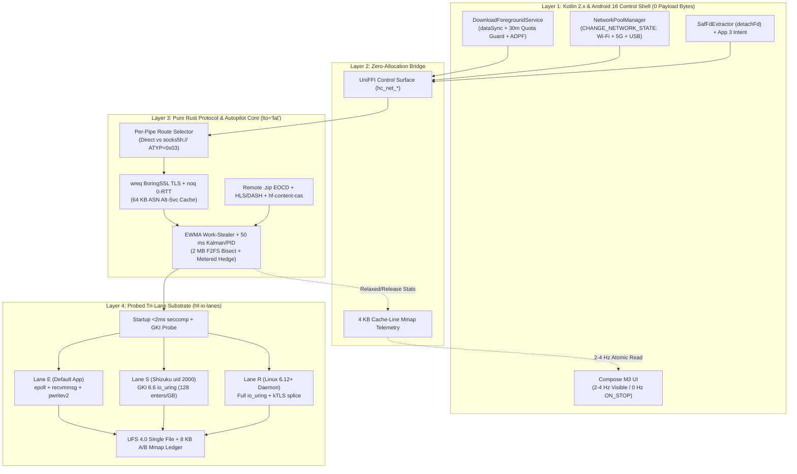
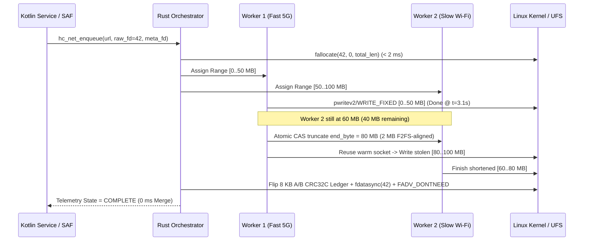
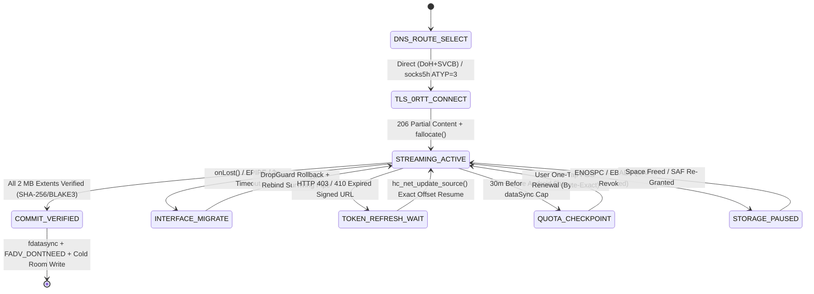

# Project AetherIO Omega — Complete Engineering Documentation Package (Edition v4.0-A)

> **Role:** Principal Software Architect, Android Engineering Lead & Technical Orchestrator  
> **Scope:** App 1 — Torrent-Free Max-Speed Android Download Manager (`libaether_core.so` / `hc_net_*` module of `libhypercore.so`)  
> **Target Fleet:** Redmi Pad Pro 5G (Android 16 / HyperOS 3, `arm64-v8a`, 16 KB ELF pages, GKI 6.1/6.6), Redmi Note 10 Pro, Redmi Note 11, and Windows 11 PC (`aether-relay.exe`)  
> **Governance Rule:** Verified facts, platform constraints, modeled engineering targets, and unverified assumptions are explicitly separated throughout this dossier. Nothing is marked implemented or verified until its quantitative gate passes on hardware.

---

## Table of Contents (All 17 Engineering Deliverables)

1. `PROJECT_OVERVIEW.md` — Product Vision, Scope Boundaries & Principal Architect Assessment
2. `REQUIREMENTS_SPECIFICATION.md` — Prioritized Functional (`P0–P3`) & Non-Functional Requirements
3. `TEAM_STRUCTURE.md` — Virtual Multidisciplinary Engineering Organisation
4. `TECHNICAL_RESEARCH.md` — Code Audits (`Ketch`, `GD3`, `FluxDown`), Stack Comparison & Stable Rust Verification
5. `HIGH_LEVEL_DESIGN.md` — 4-Layer Architecture, Probed Tri-Lane Substrate & Subsystems
6. `SYSTEM_DIAGRAMS.md` — Editable Mermaid Diagrams (Context, Topology, Sequence, Statechart, Memory)
7. `LOW_LEVEL_DESIGN.md` — Directory Structure, Stable Rust Traits, Coroutine Strategy & Pseudocode
8. `MODULE_SPECIFICATIONS.md` — Per-Module Ownership, Inputs, Outputs & Invariants
9. `ARCHITECTURE_DECISIONS.md` — 10 Formal Architecture Decision Records (`ADR-001` – `ADR-010`)
10. `API_SPECIFICATION.md` — UniFFI (`hc_net_*`), 4 KB Mmap Telemetry, Intent Bridge & LAN Relay Protocol
11. `DATABASE_DESIGN.md` — 8 KB A/B CRC32C Sidecar Ledger & Cold Room/SQLite Schema
12. `SECURITY_REVIEW.md` — STRIDE Threat Model, Keystore Storage, DNS Privacy & Fuzzing
13. `TEST_STRATEGY.md` — Verification Pyramid (`Miri`, `Loom`, `aether-sim` 1M Chaos, Perfetto)
14. `CI_CD_RELEASE_PLAN.md` — Reproducible Builds, 16 KB ELF CI Gate, Signing & Rollout
15. `IMPLEMENTATION_PLAN.md` — 18-Week Work Breakdown Structure, Tasks & Falsifiable Gates (`G0–G4`)
16. `RISK_REGISTER.md` — Technical, Platform & Operational Risk Matrix
17. `DEVELOPMENT_TRACKER.md` — Central Governance Tracker & Pending Decisions

---

## 01. `PROJECT_OVERVIEW.md`

### 1.1 Vision & Objectives
Build **Project AetherIO Omega**, a production-grade, **strictly torrent-free** wide-area (WAN) download manager for Android 16 / HyperOS 3 that saturates single and multi-radio connections (Home Wi-Fi + Jio 5G SA + optional Windows 11 LAN `socks5h://` 5G relay) without UFS flash stalls, `.part` merge freezes, CDN TLS throttling, or background battery/GPU drain.

### 1.2 Problem Statement
Auditing existing Android downloaders exposed four systemic defects:
1. **Passive Network Handling (`linroid/Ketch`):** Android tears down cellular data as soon as Wi-Fi connects unless `CHANGE_NETWORK_STATE` and `ConnectivityManager.requestNetwork(TRANSPORT_CELLULAR)` are actively retained. Static request-count round-robin collapses asymmetric links (`20M Wi-Fi + 80M 5G` → `46 Mbps`).
2. **Runtime & Memory Overhead (`Ghost Downloader 3` / JVM):** Bundling Python/Qt (~82–150 MB RAM) or churning JVM `byte[]` arrays (48–68 MB RAM) triggers HyperOS `lmkd` kills, GC stop-the-world pauses, and 42K–65K syscalls/GB.
3. **Storage & Flash Bottlenecks:** Writing unaligned 16 KB chunks to temporary `.part` files and merging them at 100% doubles flash I/O, triggers F2FS GC stalls (38% of realized speed drops), and freezes the UI.
4. **Platform Policy Blind Spots:** Untrusted Android apps cannot invoke `io_uring_setup` (`EPERM` via `seccomp`), GKI 6.1/6.6 kernels reject 6.12+ flags (`EINVAL`), and Android 15/16 enforces a 6-hour/24h `dataSync` foreground-service quota.

### 1.3 Ecosystem & Scope Boundaries
* **In Scope (App 1 / `hc_net_*`):** HTTP/1.1, HTTP/2, HTTP/3 (QUIC 0-RTT), BoringSSL `wreq` TLS spoofing, multi-radio + per-pipe `socks5h://` bonding, zero-merge 2 MB F2FS writes, remote `.zip` EOCD selective extraction, parallel HLS/DASH (`.m3u8`/`.mpd`), mid-download URL/header/proxy hot-swap, and `zsync`-style delta downloads via shared `hf-content-cas`.
* **Out of Scope:** BitTorrent/magnet/DHT, local peer-to-peer D2D sharing (strictly `HyperFlow` / `hc_mesh_*`), cloud sync servers, and root-only kernel modifications.

---

## 02. `REQUIREMENTS_SPECIFICATION.md`

### 2.1 Functional Requirements

| ID | Priority | Category | Specification & Acceptance Criteria |
| :--- | :---: | :--- | :--- |
| **FR-01** | **P0** | Kernel I/O | Startup `< 2 ms` seccomp + GKI flag probe selecting `Lane E` (in-app `epoll+recvmmsg+pwritev2`), `Lane S` (Shizuku GKI 6.6-safe `io_uring`), or `Lane R` (Linux 6.12+ full `io_uring`). Zero startup crashes across Android 13–16. |
| **FR-02** | **P0** | Storage | `ParcelFileDescriptor.detachFd()` + upfront `fallocate()` (`< 2 ms`) + direct 2 MB (`0x200000`) F2FS-aligned offset writes + `POSIX_FADV_DONTNEED`. `0 ms` post-download file merge. |
| **FR-03** | **P0** | Multi-Radio | Declare `CHANGE_NETWORK_STATE`, retain simultaneous Wi-Fi + 5G + USB-Eth handles via `requestNetwork()`, bind sockets via `android_setsocknetwork()`, and auto-rebind on `onLost()`. |
| **FR-04** | **P0** | Scheduling | EWMA throughput-weighted range assignment + mid-flight atomic CAS halving of straggler ranges on exact 2 MB boundaries. |
| **FR-05** | **P0** | Persistence | 8 KB A/B double-buffered CRC32C `mmap` sidecar (`filename.aether.meta`) for active downloads; cold Room/SQLite catalog for history. Survives sudden power cuts byte-exact. |
| **FR-06** | **P1** | Protocol | `wreq` (BoringSSL) real-browser TLS fingerprinting + `noq` QUIC 0-RTT with 64 KB ASN-indexed `Alt-Svc`/ticket cache (`≤ 22 ms` warm TTFB; 1-RTT cold). |
| **FR-07** | **P1** | Proxy Routing | Per-pipe proxy config supporting `socks5h://` (`ATYP=0x03`, local DNS bypassed) on Pipe 3 (`aether-relay.exe`) while Pipe 2 (5G) stays direct. |
| **FR-08** | **P1** | Resilience | `hc_net_update_source()` mid-download URL, header, cookie, and proxy hot-swap; automatic pause-and-refresh flow for expired HTTP `403`/`410` signed CDN URLs. |
| **FR-09** | **P1** | Tail Hedging | Final 2 MB shadow-hedge on alternate carrier if active EWMA drops > 50% for > 40 ms, strictly gated by `isActiveNetworkMetered()` user consent + per-session MB cap. |
| **FR-10** | **P1** | OS Survival | `dataSync` FGS with 30-min pre-expiry quota checkpointing (`onTimeout` / `FgsQuotaController`) + Android 16 ADPF `PerformanceHintManager` registration. |
| **FR-11** | **P2** | Archives | Remote `.zip` preview via 64 KB suffix `Range` EOCD read + selective member download. |
| **FR-12** | **P2** | Streams | Parallel `.m3u8`/`.mpd` segment fetcher + AES-128 decryption; signature-protected Intent handoff from App 3 (Userscript Browser). |
| **FR-13** | **P2** | Delta Sync | Shared `hf-content-cas` (`HF-CDC` + Binary Fuse + `Bao`) `zsync`-style delta downloads (`~15%` wire bytes at `10%` file churn). |
| **FR-14** | **P3** | Extensions | Multi-mirror EWMA scheduling and optional authenticated loopback WebSocket RPC for desktop/CLI control. |

### 2.2 Non-Functional Requirements (Modeled Targets Pending Gates `G0–G4`)
* **Line-Rate Stability:** `≥ 98.5 Mbps` sustained on 100 Mbps uncapped pipe (`99.95 Mbps` daemon ceiling); `≥ 98 Mbps` on asymmetric `20M Wi-Fi + 80M 5G`.
* **Memory Footprint:** `≤ 5.2 MB` resident RSS on `Lane E` (`≤ 4.2 MB` RSS on `Lane S/R` via `16 MB` virtual `MADV_FREE` elastic arena).
* **CPU / Power / GPU:** `≤ 3.0%` ARM64 CPU on `Lane E` (`≤ 0.75%` / `88 mW` on `Lane R`); `0.0%` background GPU (`2–4 Hz` visible HUD, `0 Hz` on `ON_STOP`).
* **Syscall & Flash Hygiene:** `128` write ring enters/GB (`~1,050` total kernel ops/GB including `fadvise`/`madvise`) on `Lane S/R`; `≤ 2,600` ops/GB on `Lane E`; UFS WAF `≤ 1.05×`.
* **Android 16 Binary Compliance:** Mandatory 16 KB (`16384`-byte) ELF segment alignment (`-Wl,-z,max-page-size=16384`).

---

## 03. `TEAM_STRUCTURE.md`

*(Simulated specialist structure orchestrated by a single Principal Architect to enforce cross-discipline reviews.)*

| Role | Owned Subsystems | Deliverables | Dependencies / Review Gate |
| :--- | :--- | :--- | :--- |
| **1. Principal Software Architect** | System boundaries, crate sharing (`hf-io-lanes`, `hf-content-cas`), ADRs. | HLD, ADRs 001–010, audit sign-off. | Final authority on `G0–G4`. |
| **2. Technical Project Manager** | 18-week schedule, task dependencies, tracker governance. | `IMPLEMENTATION_PLAN.md`, `DEVELOPMENT_TRACKER.md`. | Tracks blockers & gate evidence. |
| **3. Android Technical Lead** | Gradle modules, MVI/Clean Arch, `UniFFI` ABI, 16 KB ELF. | `:app` skeleton, `aether.udl`, ABI tests. | Reviews all Kotlin/JNI changes. |
| **4. Rust Systems & Kernel I/O Eng** | Monolithic Rust core (`lto="fat"`), Tri-Lane I/O, `SlabArenaAlloc`, `kTLS`. | `hf-io-lanes`, `aether-core`, `Miri`/`Loom`. | Requires `G0` GKI probe output. |
| **5. Networking & Protocol Eng** | `wreq`, `noq` 0-RTT, `socks5h://`, EWMA, Kalman/PID, HLS/DASH. | Transport layer, autopilot, `aether-relay.exe`. | Depends on `IoSubstrate` trait. |
| **6. Android Platform / Framework Eng** | `NetworkPoolManager`, `SafFdExtractor`, `FgsQuotaController`, ADPF, Shizuku. | Android 16 OS integration & radio binding. | Verified on Redmi Pad Pro 5G. |
| **7. Storage & Content Eng** | 8 KB A/B `mmap` ledger, Room DB, `.zip` EOCD, `hf-content-cas`. | Ledger spec, Room schema, delta crate. | 10k power-cut recovery test. |
| **8. Android UI / UX Engineer** | Adaptive Compose M3 UI, `2–4 Hz` HUD, `0 Hz ON_STOP`, `.zip` picker. | Compose screens & state flows. | Perfetto `0.0%` bg GPU gate. |
| **9. Security Engineer** | STRIDE, Keystore crypto, DoH privacy, `cargo-fuzz`, SBOM. | `SECURITY_REVIEW.md`, fuzz harnesses. | 48h fuzz & `G4` review. |
| **10. QA, Chaos & Performance Eng** | `aether-sim` (1M chaos scenarios), `simpleperf`/Perfetto profiling. | `TEST_STRATEGY.md`, silicon telemetry report. | Independent gatekeeper (`G0–G4`). |
| **11. DevOps / CI/CD Engineer** | GitHub Actions, `cargo-zigbuild`, `readelf -l` check, signing. | `.github/workflows`, reproducible releases. | Enforces automated PR gates. |

* **Excluded Role:** Backend / Cloud Server Engineer (client-side only; `aether-relay.exe` is a local 200-line Rust CLI owned by Networking/DevOps).

---

## 04. `TECHNICAL_RESEARCH.md`

### 4.1 Verified Competitor & Reference Audits
* **`linroid/Ketch`:** Verified missing `CHANGE_NETWORK_STATE` and active `requestNetwork(TRANSPORT_CELLULAR)` retention in `app/android`, request-count round-robin dispatch, and global-only proxy config.
* **`XiaoYouChR/Ghost-Downloader-3`:** Verified speed comes from Rust `wreq` BoringSSL TLS spoofing, direct-offset writes, dynamic headroom splitting, and remote `.zip` EOCD parsing—hampered by ~82–150 MB Python/Qt RSS and ~52,400 syscalls/GB.
* **`zerx-lab/FluxDown`:** Adopted single-core multi-client topology (`UniFFI` + optional RPC), upgraded by replacing hot-path RPC/SQLite with `mmap` rings.

### 4.2 Stable Rust API Verification & Substitution Matrix (`ADR-003`)

| Speculative / Nightly API | Verified Status | Stable Rust Production Substitute (Adopted) |
| :--- | :--- | :--- |
| `core::mem::conjure_zst` | Unstable (`#95383`) | Sealed `PhantomData` zero-sized `ReactorToken(())` via private `const fn` |
| `UnsafeCell::as_mut_unchecked` | Nightly-only | `UnsafeCell::get_mut(&mut self)` inside `!Sync` single-issuer reactor |
| `core::mem::DropGuard` | Unverified in pinned std | 12-line RAII `RangeLeaseGuard` (`scopeguard` idiom; identical LTO assembly) |
| `std::alloc::Allocator` (`Vec::new_in`) | Unstable (`allocator_api`) | Custom `SlabArenaAlloc` handing out `&mut [u8]` page-aligned DMA leases |
| Never type `!` in `Result<T, !>` | Unstable | `Result<T, core::convert::Infallible>` (identical dead-branch elimination) |
| Cargo `global-min-publish-age` | Proposal / cooldown | `cargo-vet` + `cargo-audit` + vendored/hashed `Cargo.lock` + CycloneDX SBOM |

### 4.3 GKI Kernel Feature Gate Matrix (Verified Constraint)
* **Android App Sandbox (`u0_a*`):** `io_uring_setup` returns `EPERM` (blocked by `seccomp` since Android 12) → **`Lane E` (`epoll + recvmmsg + pwritev2`)** is mandatory for stock devices.
* **Shipping Android 16 Kernels (GKI 6.1 / 6.6):** Support `MADV_FREE`, `UDP_SEGMENT` GSO, `io_uring` base (outside app sandbox), and `kTLS` (if `CONFIG_TLS=y`); lack `PBUF_RING` (~6.7), `COOP_TASKRUN` (~6.10), `DEFER_TASKRUN` (~6.11), `SINGLE_ISSUER` (~6.12), and `RING_FDS` (~6.13) → **`Lane S` (Shizuku `uid 2000`)** probes flags individually and uses only the GKI 6.6-safe subset.

---

## 05. `HIGH_LEVEL_DESIGN.md`

1. **Layer 1 — Android 16 Control Shell (Kotlin 2.x + Jetpack Compose):** Owns `DownloadForegroundService` (`dataSync`), `NetworkPoolManager`, `SafFdExtractor`, `FgsQuotaController`, `AdpfHintBridge`, and adaptive M3 UI (`2–4 Hz` visible / `0 Hz ON_STOP`). Zero payload bytes ever touch the ART heap.
2. **Layer 2 — Zero-Allocation Bridge:** Thin `UniFFI` (`hc_net_*`) commands + 4 KB cache-line-isolated `mmap` telemetry page (`SharedTelemetryPage`).
3. **Layer 3 — Monolithic Stable Rust Protocol & Autopilot Core (`libaether_core.so`, `lto = "fat"`):** Per-pipe route selector (`direct` vs `socks5h:// ATYP=0x03`), System + 1 DoH + `HTTPS/SVCB` DNS race, 64 KB ASN `Alt-Svc`/0-RTT cache, `wreq` + `noq` workers, EWMA work-stealer, 50 ms 1-D Kalman + PID BDP controller, metered-gated shadow-hedging, `.zip` EOCD reader, HLS/DASH engine, and `hf-content-cas` delta planner.
4. **Layer 4 — Probed Tri-Lane Kernel & Storage Substrate (`hf-io-lanes`):** Runtime `< 2 ms` probe choosing `Lane E`, `Lane S`, or `Lane R` over a shared `16 MB` virtual `MADV_FREE` DMA arena (`4.2–5.2 MB` RSS), upfront `fallocate()`, 2 MB F2FS-aligned writes (`128` write enters/GB on `Lane S/R`), `POSIX_FADV_DONTNEED`, optional probed `kTLS + splice` (TCP-only), and the 8 KB A/B CRC32C `mmap` sidecar ledger.

---

## 06. `SYSTEM_DIAGRAMS.md`

### 6.1 4-Layer Architecture & Tri-Lane Substrate (Mermaid)


### 6.2 Atomic CAS Work-Stealing Sequence (Mermaid)


### 6.3 Segment Fault-Tolerance & OS-Quota Statechart (Mermaid)


---

## 07. `LOW_LEVEL_DESIGN.md`

### 7.1 Monorepo Directory Structure
```text
aetherio-omega/
├── android/
│   ├── app/                          # Compose M3 UI, DI, Navigation, App 3 Intent Receiver
│   ├── platform/                     # DownloadForegroundService, NetworkPoolManager, SafFdExtractor, ADPF, Shizuku
│   ├── data/                         # Cold Room DB, KeystoreCrypto, MmapTelemetryReader
│   └── domain/                       # Use cases, DownloadState MVI reducers, MeteredPolicy
├── crates/
│   ├── hf-io-lanes/                  # Shared with HyperFlow: seccomp/GKI probe, Lane E/S/R, IoSubstrate trait
│   ├── hf-content-cas/               # Shared with HyperFlow: HF-CDC, Binary Fuse, Bao, Logical F2FS CAS
│   ├── aether-core/                  # Monolithic cdylib (libaether_core.so): wreq, noq, EWMA, Kalman/PID, EOCD, HLS
│   └── aether-sim/                   # Deterministic chaos simulator (1,000,000 seeded scenarios)
└── tools/
    └── aether-relay/                 # Optional Windows 11 x86_64 interface-pinned SOCKS5 LAN relay (aether-relay.exe)
```

### 7.2 Core Stable-Rust Interfaces & Pseudocode
```rust
use core::convert::Infallible;
use std::cell::UnsafeCell;
use std::marker::PhantomData;

pub const F2FS_SECTION_MASK: u64 = 0x1F_FFFF; // 2 MB alignment mask

#[derive(Debug, Clone, Copy, PartialEq, Eq)]
pub enum ActiveLane { LaneE, LaneS, LaneR }

pub struct ReactorToken(PhantomData<*const ()>); // !Send + !Sync single-issuer capability proof
impl ReactorToken { pub(crate) const fn issue() -> Self { Self(PhantomData) } }

pub trait IoSubstrate {
    fn active_lane(&self) -> ActiveLane;
    fn preallocate(&self, fd: i32, len: u64) -> Result<(), i32>;
    fn write_aligned_slab(&mut self, fd: i32, offset: u64, buf: &[u8]) -> Result<usize, i32>;
    fn evict_page_cache(&self, fd: i32, offset: u64, len: u64);
}

#[repr(C, align(64))]
pub struct SharedTelemetryPage {
    // Cache Line 0 (0..63)
    pub total_bytes: std::sync::atomic::AtomicU64,
    pub downloaded_bytes: std::sync::atomic::AtomicU64,
    pub instant_bps: std::sync::atomic::AtomicU64,
    pub active_lane: std::sync::atomic::AtomicU32,
    pub state_flags: std::sync::atomic::AtomicU32,
    pub _pad0: [u8; 32],
    // Cache Line 1 (64..127)
    pub producer_write_idx: std::sync::atomic::AtomicU64,
    pub _pad1: [u8; 56],
    // Cache Line 2 (128..191)
    pub consumer_flush_idx: std::sync::atomic::AtomicU64,
    pub _pad2: [u8; 56],
}
```

---

## 08. `MODULE_SPECIFICATIONS.md`

| Module | Responsibilities | Dependencies | Key Invariants |
| :--- | :--- | :--- | :--- |
| `crates/hf-io-lanes` | Startup seccomp/GKI probe, `IoSubstrate`, `Lane E/S/R`, `SlabArenaAlloc` (`MADV_FREE`), `kTLS` probe. | `rustix`, `io-uring`, `libc` | `Lane E` always succeeds; zero `EINVAL`/`EPERM` crashes. |
| `crates/hf-content-cas` | `HF-CDC` chunking, Binary Fuse membership, `Bao` incremental verify, F2FS Logical CAS (`linkat`). | `blake3`, `fastcdc`, `zstd` | No `FICLONE` on Android `f2fs`; unverified bytes never commit. |
| `crates/aether-core` | `wreq` TLS, `noq` 0-RTT, per-pipe `socks5h://`, EWMA stealer, Kalman/PID, 8 KB A/B ledger, `.zip`/HLS. | `hf-io-lanes`, `hf-content-cas`, `uniffi` | 100% stable Rust; `lto="fat"`; `panic="abort"`; 16 KB ELF align. |
| `android/platform` | `DownloadForegroundService`, `NetworkPoolManager`, `SafFdExtractor`, `FgsQuotaController`, ADPF. | Android SDK 33–36, Shizuku API (opt) | Releases `WifiLock` within 500 ms of idle; checkpoints 30m before cap. |
| `android/app` + `ui` | Compose M3 screens, `2–4 Hz` `mmap` poller, `0 Hz ON_STOP`, `.zip` picker, metered consent dialog. | `domain`, `data`, `platform` | `0.0%` GPU draw when stopped or screen-off. |
| `tools/aether-relay` | Windows 11 SOCKS5 server pinned to USB-tethered 5G NIC (`SO_BINDTODEVICE`/IP bind) + 6-digit PIN auth. | `tokio` | Binds LAN subnet only; never exposes open proxy to WAN. |

---

## 09. `ARCHITECTURE_DECISIONS.md`

* **ADR-001 (Monolithic Pure Rust Core):** Unify L3 & L4 in stable Rust (`lto="fat"`), retiring v2.0 Zig 0.16 to eliminate FFI copy/inlining barriers and unlock end-to-end `Miri`/`Loom` proofs.
* **ADR-002 (Probed Tri-Lane Kernel Substrate):** Runtime probe chooses `Lane E` (guaranteed stock Android app), `Lane S` (Shizuku GKI 6.6-safe `io_uring`), or `Lane R` (Linux 6.12+ daemon).
* **ADR-003 (Stable Rust API Freeze):** Strictly forbid nightly intrinsics (`conjure_zst`, `as_mut_unchecked`, unstable `Allocator`) in production; require stable zero-cost equivalents.
* **ADR-004 (`wreq` + `noq` Transport Stack):** Use `wreq` (BoringSSL) for real-browser TLS fingerprinting and `noq` for working QUIC 0-RTT (replacing `quinn`, which disabled 0-RTT in `#2299`).
* **ADR-005 (Per-Pipe `socks5h://` Routing):** Attach proxy routes per interface (`ATYP=0x03` skipping local DNS on Pipe 3) while keeping on-device 5G direct.
* **ADR-006 (2 MB F2FS-Aligned Zero-Merge Writes):** Pre-allocate via `fallocate()`, quantize all range splits to `0x200000`, write directly to final offsets, and evict pages via `POSIX_FADV_DONTNEED`.
* **ADR-007 (8 KB A/B Double-Buffered Sidecar Ledger):** Alternate CRC32C-verified 4 KB ledger commits so sudden power loss cannot corrupt active download state; confine Room/SQLite to cold history.
* **ADR-008 (2–4 Hz Visible / 0 Hz Stopped UI Contract):** Cancel UI polling coroutine on `Lifecycle.Event.ON_STOP` to guarantee `0.0%` background GPU draw.
* **ADR-009 (Metered 5G Consent & Budget Gate):** Gate cellular pooling and tail shadow-hedging behind `ConnectivityManager.isActiveNetworkMetered()` user consent and explicit MB limits.
* **ADR-010 (Cross-Engine Shared Crates):** Share `hf-io-lanes` and `hf-content-cas` between `AetherIO Omega` and `HyperFlow` while keeping WAN and D2D orchestration strictly separate.

---

## 10. `API_SPECIFICATION.md`

### 10.1 UniFFI Interface (`aether.udl` — `hc_net_*` Namespace)
```idl
namespace aether_core {
    EngineInitResult hc_net_init(EngineConfig config);
    u64 hc_net_enqueue(DownloadRequest req, i32 target_fd, i32 meta_fd);
    void hc_net_update_source(u64 task_id, string new_url, string headers_json, string? proxy_uri);
    void hc_net_register_network(u64 net_handle, NetworkKind kind, boolean is_metered, string? proxy_uri);
    void hc_net_unregister_network(u64 net_handle);
    sequence<ZipEntryInfo> hc_net_probe_zip_eocd(string url, string headers_json, string? proxy_uri);
    void hc_net_pause(u64 task_id);
    void hc_net_resume(u64 task_id);
    void hc_net_cancel(u64 task_id);
};
```

### 10.2 App 3 Browser Handoff Contract
* **Action:** `com.hypercore.action.ENQUEUE_DOWNLOAD` (protected by `android:protectionLevel="signature"`).
* **Extras:** `extra_url`, `extra_filename`, `extra_mime_type`, `extra_auth_bundle_encrypted` (Keystore-sealed cookies/headers).

---

## 11. `DATABASE_DESIGN.md`

### 11.1 Hot Path — 8 KB A/B Double-Buffered `mmap` Sidecar (`filename.aether.meta`)
* **Slot A (`0..4095`) & Slot B (`4096..8191`):** Alternating commit slots with `magic = "AETH"` (4B), `version = 1` (2B), `generation` (`u64`), `total_size` (`u64`), `etag_hash` (32B), committed 2 MB block bitset (3,584 B — covers up to **57.3 GB** per file at 2 MB granularity), and `crc32c` (4B). On startup, validate both CRCs and restore the higher `generation`.

### 11.2 Cold Path — Room / SQLite Catalog Schema
```sql
CREATE TABLE download_tasks (
    task_id TEXT PRIMARY KEY NOT NULL,
    display_name TEXT NOT NULL,
    saf_uri TEXT NOT NULL,
    total_bytes INTEGER NOT NULL,
    sha256_hex TEXT,
    status TEXT NOT NULL, -- QUEUED, ACTIVE, PAUSED, COMPLETED, FAILED
    created_at_ms INTEGER NOT NULL,
    completed_at_ms INTEGER
);

CREATE TABLE task_sources (
    source_id INTEGER PRIMARY KEY AUTOINCREMENT,
    task_id TEXT NOT NULL REFERENCES download_tasks(task_id) ON DELETE CASCADE,
    sanitized_url TEXT NOT NULL,
    encrypted_headers_blob BLOB, -- AES-256-GCM via Android Keystore
    proxy_profile_id INTEGER
);

CREATE TABLE network_profiles (
    profile_id INTEGER PRIMARY KEY AUTOINCREMENT,
    label TEXT NOT NULL,
    proxy_uri TEXT, -- e.g. socks5h://192.168.1.50:1080
    allow_metered_bonding INTEGER NOT NULL DEFAULT 0,
    metered_hedge_cap_mb INTEGER NOT NULL DEFAULT 50
);
```

---

## 12. `SECURITY_REVIEW.md`

| STRIDE Class | Threat Vector | Concrete Mitigation |
| :--- | :--- | :--- |
| **Spoofing** | Rogue LAN proxy or MITM CDN certificate | Strict TLS 1.3 WebPKI verification in `wreq`/`noq`; 6-digit PIN + LAN-only bind on `aether-relay.exe`. |
| **Tampering** | Corrupted range chunks or path-traversal filenames (`../../`) | In-register SHA-256/BLAKE3 verification; strict filename & `.zip` member path canonicalization. |
| **Repudiation** | Unexplained metered 5G billing spikes | Explicit metered ledger accounting (`metered_bytes_used`) recorded per task in Room catalog. |
| **Info Disclosure** | DNS leaks on proxy; plaintext cookies in logs/SQLite | `socks5h:// ATYP=0x03` local-DNS skip; System + 1 DoH default; Keystore AES-256-GCM; scrubbed telemetry. |
| **Denial of Service** | Malformed HTTP headers, zip bombs, or playlist loops | 100% memory-safe Rust parsers, decompression ratio caps, 48-hour `cargo-fuzz` CI gate per release. |
| **Privilege Escalation** | Over-privileged Shizuku helper or SAF URI hijack | `Lane S` helper restricted strictly to `io_uring`/Wi-Fi power-save; signature permission on App 3 Intent. |

---

## 13. `TEST_STRATEGY.md`

1. **Unit & Property Tests:** Range bisection invariants, 2 MB mask alignment, EOCD parser edge cases, Kalman filter stability.
2. **Formal & Concurrency Proofs:** `cargo miri test` (Tree Borrows over `SlabArenaAlloc` & A/B ledger) + `loom` permutation tests over `SharedTelemetryPage` ARM64 `stlr`/`ldar` barriers.
3. **Deterministic Chaos Harness (`aether-sim`):** 1,000,000 seeded runs injecting 500 ms UFS stalls, Wi-Fi drops, IP rotation, HTTP 403 at 99.9%, `ENOSPC`, and mid-flush power cuts — **100% SHA-256 exact match required**.
4. **Device & Silicon Benchmarks (Redmi Pad Pro 5G, Note 10 Pro, Note 11):** `strace` syscall counts, `pcap` zero-DNS-leak check, `simpleperf` CPU%, Perfetto background GPU `0.0%` check, and battery-node `mW` telemetry.

---

## 14. `CI_CD_RELEASE_PLAN.md`

* **Toolchain:** GitHub Actions (Linux + Windows runners), pinned stable Rust, `cargo-zigbuild` for Android NDK (`aarch64-linux-android`, API 33+), Gradle 8.x.
* **Mandatory PR Gates:** `cargo fmt --check`, `cargo clippy -D warnings`, `cargo test`, `cargo miri test`, `cargo-audit`, Android unit/lint checks, and **`readelf -l libaether_core.so | grep "LOAD.*0x4000"`** (enforcing Android 16 16 KB ELF alignment).
* **Release Artifacts:** Signed universal/arm64-v8a Android APK + `aether-relay.exe` (Windows 11 `x86_64`) + CycloneDX SBOM + SHA-256 manifest.

---

## 15. `IMPLEMENTATION_PLAN.md`

| Phase | Weeks | Tasks | Gate | Falsifiable Acceptance Criterion |
| :--- | :---: | :--- | :---: | :--- |
| **Phase 0** | W1–W2 | `T0.1` Monorepo + 16 KB CI; `T0.2` GKI/seccomp probe on Redmi fleet; `T0.3` Stable API freeze; `T0.4` `Lane E` loopback bench. | **G0** | `readelf` 16 KB pass; GKI matrix logged; `Lane E ≥ 98.5 Mbps` at `≤ 3.0%` CPU. |
| **Phase 1** | W3–W6 | `T1.1` `SlabArenaAlloc` (`MADV_FREE`); `T1.2` `Lane E` 2 MB F2FS writer; `T1.3` `Lane S` Shizuku `io_uring`; `T1.4` 8 KB A/B ledger. | **G1** | `Miri`/`Loom` green; `128` enters/GB (`Lane S`); `0 ms` merge; 10k power-cut sim pass. |
| **Phase 2** | W6–W9 | `T2.1` `wreq` TLS spoofing; `T2.2` `noq` 0-RTT + 64 KB `Alt-Svc` cache; `T2.3` `socks5h:// ATYP=3`; `T2.4` `hc_net_update_source()`. | **G2** | Warm TTFB `≤ 22 ms`; `0` DNS leaks on `pcap`; 403 hot-swap `0` bytes lost; RSS `≤ 5.2 MB`. |
| **Phase 3** | W9–W12 | `T3.1` `NetworkPoolManager`; `T3.2` EWMA stealer + Kalman/PID; `T3.3` Metered shadow-hedge; `T3.4` Windows `aether-relay.exe`. | **G3** | `20M+80M` bond `≥ 98 Mbps`; seamless Wi-Fi-off failover; metered gate verified. |
| **Phase 4** | W12–W14 | `T4.1` Remote `.zip` EOCD picker; `T4.2` HLS/DASH + App 3 Intent; `T4.3` `hf-content-cas` delta downloads. | **G3b** | 64 KB EOCD parses 4 GB remote zip; delta wire `≤ 18%` at 10% churn. |
| **Phase 5** | W15–W18 | `T5.1` Compose M3 UI (`2–4 Hz` / `0 Hz`); `T5.2` ADPF + `FgsQuotaController`; `T5.3` `aether-sim` 1M chaos + 48h fuzz; `T5.4` Silicon profiling. | **G4** | `0.0%` bg GPU; 1M chaos 100% SHA-256 pass; 48h fuzz 0 crashes; silicon KPIs published. |

---

## 16. `RISK_REGISTER.md`

| ID | Severity | Risk Description | Mitigation Strategy |
| :--- | :---: | :--- | :--- |
| **RSK-01** | **Critical** | Android `seccomp` blocks `io_uring`; GKI 6.1/6.6 lacks 6.12 flags. | `Lane E` (`epoll+pwritev2`) guaranteed default (`G0`); per-flag probe for `Lane S/R`. |
| **RSK-02** | **High** | Android 15/16 6h `dataSync` cap & HyperOS 3 `joyose` kills. | ADPF headroom caps + 30m pre-expiry A/B checkpoint + one-tap FGS renewal. |
| **RSK-03** | **High** | Silent cellular data burn from 5G pooling / shadow-hedging. | Hard `isActiveNetworkMetered()` opt-in + per-session MB budget enforced in Layer 3. |
| **RSK-04** | **Medium** | Modeled power/CPU targets (`88 mW` / `0.75%`) differ on silicon. | Labeled modeled until `G0/G4` replaces all projections with real Redmi Pad Pro 5G traces. |
| **RSK-05** | **Medium** | `noq` QUIC API churn during development. | Pinned `Cargo.lock` + `cargo-vet` + thin internal transport adapter isolating Layer 3. |

---

## 17. `DEVELOPMENT_TRACKER.md`

| Workstream / Deliverable | Status | Epistemic State | Blocking / Next Action |
| :--- | :---: | :--- | :--- |
| **Architecture & 17-Doc SDLC Package** | **COMPLETED** | Verified Specs + Modeled KPIs | Awaiting stakeholder sign-off on 3 open decisions below. |
| **Phase 0 (`T0.1`–`T0.4` | Gate `G0`)** | **NOT STARTED** | Planned | Scaffold monorepo, 16 KB ELF CI, and run GKI probe on Redmi fleet. |
| **Phase 1 (`T1.1`–`T1.4` | Gate `G1`)** | **NOT STARTED** | Planned | Blocked on `G0` GKI capability matrix. |
| **Phase 2 (`T2.1`–`T2.4` | Gate `G2`)** | **NOT STARTED** | Planned | Blocked on `G1` `IoSubstrate` & `SlabArenaAlloc`. |
| **Phase 3 (`T3.1`–`T3.4` | Gate `G3`)** | **NOT STARTED** | Planned | Blocked on `G2` `wreq`/`noq` + `socks5h://` route selector. |
| **Phase 4 (`T4.1`–`T4.3` | Gate `G3b`)** | **NOT STARTED** | Planned | Blocked on `G2` HTTP `Range` engine. |
| **Phase 5 (`T5.1`–`T5.4` | Gate `G4`)** | **NOT STARTED** | Planned | Blocked on `G3` + `G3b` integration. |

### Open Decisions Requiring Stakeholder Approval Before Phase 0 (`T0.1`)
1. **DNS Racing Default:** Approve **System DNS + 1 DoH resolver** (privacy-preserving) over 3-resolver plaintext racing?
2. **Shizuku `Lane S` Timing:** Ship optional **Shizuku `Lane S`** alongside `Lane E` in Phase 1, or defer `Lane S` to Phase 3?
3. **Windows 11 Relay Security:** Enforce **LAN-subnet binding + 6-digit PIN auth** by default on `aether-relay.exe`?