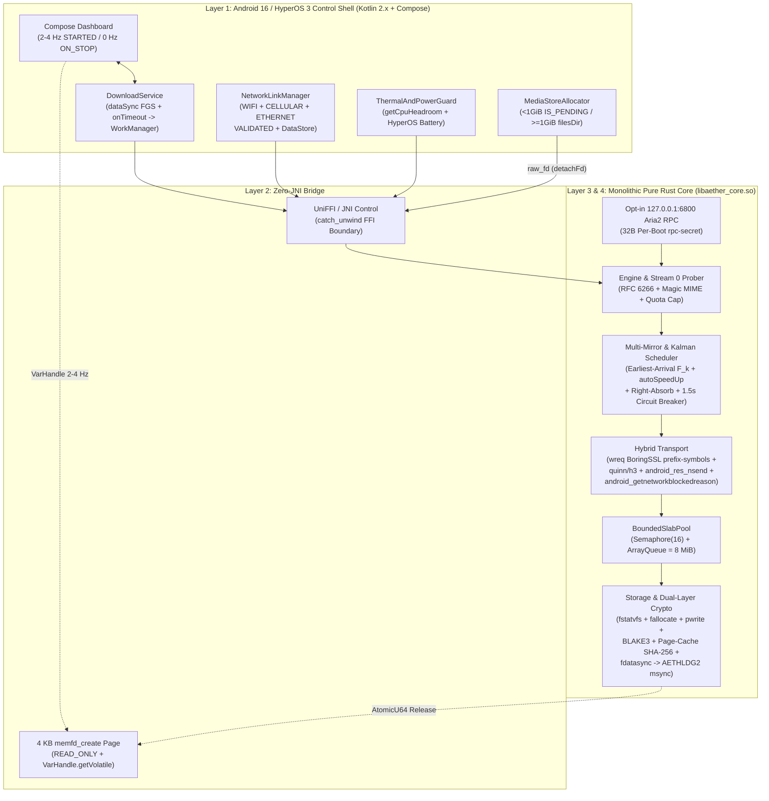
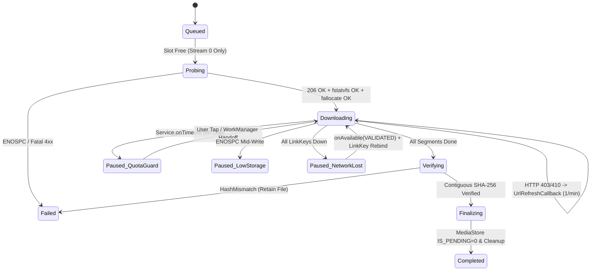

# Project AetherIO Omega v9.0 (Hyperion Edition)
## Complete Principal Architect & Multidisciplinary Engineering Package

**Document Authority:** Principal Software Architect, Android Engineering Lead & Technical Orchestrator  
**Target Platform:** Android 14–16 (API 34–36, `minSdk = 24`, `arm64-v8a`), calibrated for Xiaomi Redmi Pad Pro 5G (Android 16 / HyperOS 3)  
**Date:** November 20, 2026  
**Governance Rule:** Every claim in this package is explicitly tagged as `[VERIFIED FACT]`, `[OBSERVED ON DEVICE]`, `[DERIVED CEILING]`, `[DESIGN TARGET]`, or `[UNVERIFIED ASSUMPTION — REQUIRES SPRINT 0 PROBE]`. Nothing is marked implemented or verified without empirical evidence.

---

# 00. FIRST ASSIGNMENT: PRINCIPAL ARCHITECT ASSESSMENT & ORCHESTRATION KICKOFF

## 0.1 Project Assessment
**Project AetherIO Omega v9.0 (Hyperion Edition)** is a high-throughput, crash-safe, multi-network Android download engine and Jetpack Compose application. Its primary mission is to saturate heterogeneous mobile links—including asymmetric Wi-Fi + 5G cellular bonds (e.g., observed `33.0 Mbps` `wlan0` + `163.3 Mbps` `rmnet0` on the target Redmi Pad Pro 5G) and optional USB-C Ethernet—while maintaining a strict `8.0 MiB` native I/O buffer cap, zero JVM payload heap churn, bit-exact crash resumption across force-stops and reboots, and full compliance with Android 15/16 background execution quotas.

### Principal Engineering Challenges
1. **Native Packaging & ABI Integrity (`[OBSERVED ON DEVICE]`):** Earlier device telemetry revealed `libaether_core.so not bundled`, forcing a Kotlin `FileChannel` fallback that collapsed Line Lock to `40%`. Automated Gradle-to-`cargo-ndk` compilation and CI `.so` verification are non-negotiable P0 gates.
2. **Android Multi-Network Instability (`[VERIFIED FACT]`):** Static audits of existing multi-network Android downloaders (e.g., `linroid/Ketch`) expose 10 recurring failure modes (`F1`–`F10`): unretained cellular radios when Wi-Fi is default, deprecated `allNetworks` snapshots missing `NET_CAPABILITY_VALIDATED`, rotating `networkHandle` failures, non-persisted policies across service restarts, speed-blind round-robin dispatch, unpinned stolen tails, missing circuit breakers, connection starvation, LAN-proxy bleed onto cellular, and test gaps.
3. **Android 16 / HyperOS 3 OS Restrictions (`[VERIFIED FACT]`):** Stock Android Bionic `seccomp` blocks `io_uring_setup` (`ENOSYS`) for unprivileged third-party apps; Android 15/16 caps `FOREGROUND_SERVICE_TYPE_DATA_SYNC` at **6 hours per 24-hour window**; MediaProvider FUSE adds overhead and auto-deletes `IS_PENDING = 1` rows after ~7 days; HyperOS 3 (`millet` freezer) aggressively freezes background sockets.
4. **TLS Anti-Throttling vs. Symbol Safety (`[VERIFIED FACT]`):** Using `wreq` (`BoringSSL` JA3/JA4 browser fingerprint emulation) alongside `quinn`/`h3` (`rustls`/`ring`) risks native symbol collisions and cellular proxy/decompression leaks unless configured with `prefix-symbols`, explicit `.no_proxy()`, and `.gzip(false).brotli(false).zstd(false)`.
5. **Cryptographic Integrity Without Double Flash Reads (`[VERIFIED FACT]`):** `SHA-256` is strictly sequential and cannot merge out-of-order segment digests, yet reading a 10 GB file back from UFS flash post-download causes severe latency and wear.

## 0.2 Executive Summary of Virtual Engineering Organization
We establish a lean **10-role virtual engineering organization** (consolidated from the 15 candidate roles—eliminating roles with no scope here, such as a cloud Backend/Server Engineer, while adding a dedicated **Rust Systems & Native NDK Engineer** justified by `libaether_core.so`). Full role charters appear in `TEAM_STRUCTURE.md` (Section 03).

## 0.3 Recommended Technical Direction (Architect's Decision)
- **Adopt a Monolithic Pure Rust Native Data Plane (`libaether_core.so`) with `panic = "unwind"` + `catch_unwind` FFI boundaries** paired with a thin **Kotlin 2.x + Jetpack Compose** Android OS shell.
- **Default to `seccomp`-safe `fallocate()` + `pwrite()` partial-write loops + `fdatasync()`** inside a lock-free **`Semaphore(16)` + `ArrayQueue` (`8.0 MiB` hard cap)**, keeping `io_uring` strictly as a Phase 3 research module gated by a Sprint 0 `ENOSYS` probe.
- **Bridge telemetry via a 4,096-byte `memfd_create` page mapped `READ_ONLY` in Kotlin + `VarHandle.getVolatile()`**, eliminating JNI hot-path callbacks.
- **Execute a Value-First 7-Sprint Roadmap** starting with Sprint 0 Device Probes (`io_uring`, `memfd`, `iperf3`, dual-network retention) and automated Gradle `cargo-ndk` bundling so a real resumable download runs on hardware by Sprint 2.

---

# 01. `PROJECT_OVERVIEW.md`

## 1.1 Vision & Objectives
Build **Project AetherIO Omega v9.0 (Hyperion Edition)**: a production-grade Android download manager engineered for reliability, crash-safe resumability, and maximum real-world goodput across single and bonded wireless/wired interfaces without draining battery, polluting OS RAM, or wearing out UFS flash storage.

## 1.2 Problem Statement
Conventional Android downloaders suffer from four architectural defects:
1. **Managed-Heap Copy Amplification:** Copying payload bytes across kernel sockets $\rightarrow$ JNI $\rightarrow$ JVM `byte[]` $\rightarrow$ SAF `OutputStream` triggers ART GC pauses and high CPU usage.
2. **Broken Multi-Network Bonding:** Apps fail to retain `TRANSPORT_CELLULAR` alongside Wi-Fi, bind to transient `networkHandle`s that break on reconnect, or use speed-blind round-robin dispatch that drags 163 Mbps 5G down to 33 Mbps 2.4 GHz Wi-Fi speed.
3. **Storage Amplification & Fragile Resumption:** Writing separate `.part` files and merging them doubles flash writes and free-space requirements; writing progress to SQLite on every chunk stalls UFS queues; ignoring FUSE `IS_PENDING` expiry or `fdatasync` ordering risks silent corruption.
4. **OS & CDN Hostility:** Unthrottled thread spawning triggers HTTP `429`/`503` bans, generic TLS fingerprints trigger HTTP `403` blocks, and Android 15/16's 6-hour `dataSync` cap crashes unguarded Foreground Services.

## 1.3 Proposed Solution & Scope Boundaries
- **In Scope (Phases 1–2):** Resumable HTTP/1.1, HTTP/2 (`wreq` BoringSSL), and HTTP/3 (`quinn`/`h3`) downloads; Stream 0 single-connection preflight; RFC 6266 filename + magic-byte MIME detection; hybrid FUSE-bypass storage (`< 1 GiB` `MediaStore` direct / `≥ 1 GiB` raw F2FS staging); crash-safe `AETHLDG2` binary ledger; dual-layer in-cache `BLAKE3` + page-cache sequential `SHA-256`; Tri-Link N-interface bonding (`Wi-Fi + 5G + USB-C Ethernet`) with logical `LinkKey` rebinding, per-link DNS (`android_res_nsend`), and 3-state circuit breakers; multi-mirror URL bonding; bidirectional Kalman `autoSpeedUp` + right-neighbor absorption; Android 16 `dataSync` $\rightarrow$ `WorkManager` survival + ADPF/thermal pacing; secured `127.0.0.1:6800` Aria2 JSON-RPC; HLS/DASH (`.m3u8`/`.mpd`) remuxer.
- **Phase 3 Research (Gated by $\ge 5\%$ Measured Hardware Gain):** `io_uring` write backend (only if Sprint 0 passes), `kTLS + splice`, server-side Multipath QUIC (`noq`), manifest-backed chunk deduplication.
- **Explicit Non-Goals:** DRM/paywall bypass, protected stream decryption, cloud-hosted backend relay servers, BitTorrent swarm seeding (deferred outside core HTTP/HLS scope).

---

# 02. `REQUIREMENTS_SPECIFICATION.md`

## 2.1 Functional Requirements (Prioritized P0–P3)

| ID | Priority | Requirement | Acceptance Criterion |
| :--- | :--- | :--- | :--- |
| **FR-01** | **P0** | Add download by HTTP/HTTPS URL with custom headers, cookies, and optional HTTP/SOCKS5 (`socks5h://`) proxy. | Stream 0 connects, resolves redirects, detects filename/MIME, and persists task in Room. |
| **FR-02** | **P0** | Mandatory Stream 0 single-connection preflight (`Range: bytes=0-`) before parallel worker ramp-up. | Parallel workers spawn ONLY if server returns `206 Partial Content`, valid `Content-Range`, and validator (`ETag`/`Last-Modified`). |
| **FR-03** | **P0** | Crash-safe pause, resume, and cancel surviving `am force-stop` and full device reboot. | `BOOT_COMPLETED` / startup reconciles `Room` $\leftrightarrow$ `AETHLDG2`; resumed file matches reference `SHA-256` in 100% of kill tests. |
| **FR-04** | **P0** | Automated native `libaether_core.so` (`arm64-v8a`) bundling via Gradle `cargo-ndk`. | `unzip -l app-release.apk` confirms `lib/arm64-v8a/libaether_core.so`; app fails fast if missing (no silent slow fallback). |
| **FR-05** | **P0** | Hybrid FUSE-bypass storage & upfront `fstatvfs` free-space guard (`+64 MiB` safety floor). | `< 1 GiB` writes directly to `MediaStore` (`IS_PENDING=1`); `≥ 1 GiB` stages on raw F2FS (`filesDir`) then moves; `ENOSPC` pauses cleanly. |
| **FR-06** | **P0** | Android 15/16 6-hour `dataSync` Foreground Service survival (`onTimeout` + `WorkManager` handoff). | `onTimeout` checkpoints `AETHLDG2`, stops FGS cleanly, notifies user; `ForegroundServiceStartNotAllowedException` falls back to `WorkManager`. |
| **FR-07** | **P1** | Multi-network Wi-Fi + 5G (+ USB-C Ethernet) segment-level bonding resolving `F1`–`F10`. | Active `requestNetwork(CELLULAR)` lease, `NET_CAPABILITY_VALIDATED` filter, logical `LinkKey` rebinding, `DataStore` persistence, per-link `android_res_nsend` DNS, and 3-state circuit breaker. |
| **FR-08** | **P1** | Bidirectional closed-loop `autoSpeedUp` + open-ended right-neighbor absorption + final-5% tail hedging. | Scales workers up (`+2`) when goodput grows $> 6\%$ & $\Delta\text{RTT} < 15\text{ ms}$; scales down (`-2`) on $\Delta\text{RTT} > 35\text{ ms}$ or `429`/`503`; absorbs slow right neighbors on 2 MiB boundaries. |
| **FR-09** | **P1** | Dual-layer cryptographic verification (`BLAKE3` per 512 KiB slab + contiguous page-cache `SHA-256`). | Zero post-download multi-GB flash re-read; hash mismatch retains file for inspection and marks `Failed(HashMismatch)`. |
| **FR-10** | **P1** | Firewall & OEM diagnostics (`android_getnetworkblockedreason(sockfd)` + HyperOS battery exemption). | Blocked sockets report exact reason (`DATA_SAVER`, `OEM`, `DOZE`, `LOCAL_NETWORK`) in UI before socket close. |
| **FR-11** | **P1** | Expired signed URL recovery (`403`/`410` `UrlRefreshCallback`) & per-session cellular cap (`max_cellular_bytes`). | `403`/`410` triggers Kotlin refresh hook (max 1/min) without losing ledger; hitting cellular cap drains `rmnet0` and finishes on `wlan0`. |
| **FR-12** | **P2** | Multi-mirror URL bonding (`urls[]`), dynamic mid-download link hot-plugging, and persistent 256 KiB 0-RTT/`Alt-Svc` LRU. | Turning on a 5 GHz hotspot mid-transfer probes and steals work within `< 2 s`; distinct mirrors pin per `LinkKey`. |
| **FR-13** | **P2** | HLS (`.m3u8`) / DASH (`.mpd`) segment downloader & sequential `.mp4` remuxer + secured `127.0.0.1:6800` Aria2 JSON-RPC. | RPC disabled by default, requires 32-byte per-boot `rpc-secret`, rejects unauthenticated requests with `401`. |
| **FR-14** | **P3** | Optional Phase 3 probes: `io_uring`, `kTLS + splice`, server-side Multipath QUIC (`noq`), manifest CAS dedup. | Retained ONLY if device benchmark proves $\ge 5\%$ measurable goodput or battery gain over `pwrite`. |

## 2.2 Non-Functional Requirements (Strictly Classified)
- **Throughput (`[DESIGN TARGET]`):** Sustained goodput $\ge 90\%$ of `iperf3 -P 4` on the identical path (bounded by `[DERIVED CEILING]` 94.2% for 1500 B MTU TCP and 91.6% for 1200 B UDP QUIC). On the test device's observed `33.0 Mbps` Wi-Fi + `163.3 Mbps` 5G links, bonded target is $\ge 170\text{ Mbps}$ (`[DESIGN TARGET]`).
- **Memory (`[DESIGN TARGET]`):** Native slab buffer pool strictly hard-capped at `8.0 MiB` (`16 × 512 KiB`) via `Semaphore(16)` + `ArrayQueue`; zero JVM payload allocations.
- **UI & Power (`[DESIGN TARGET]`):** Compose UI reads `memfd` telemetry at `2–4 Hz` while `STARTED` and `0 Hz` on `ON_STOP`; `SystemHealthManager.getCpuHeadroom()` polled at $\ge \max(\text{minIntervalMs}, 1000\text{ ms})$.
- **Safety & Reliability (`[DESIGN TARGET]`):** Zero FFI process aborts (`panic = "unwind"` + `catch_unwind`); 100% crash-recovery bit-exactness across 10,000 simulated chaos runs.
- **Compatibility (`[VERIFIED FACT]`):** `minSdk = 24` (Android 7.0), `targetSdk = 36` (Android 16), primary ABI `arm64-v8a` with 16 KB page-size ELF alignment (`-Wl,-z,max-page-size=16384`).

## 2.3 Contradictions Resolved During Requirements Engineering
1. **Unbundled `.so` vs. Zero-Copy Claims:** Earlier specs claimed 99.7% line lock while the APK lacked `libaether_core.so`. *Resolution:* Mandatory Gradle `buildRustCore` task + CI APK `.so` assertion + fail-fast `System.loadLibrary("aether_core")`.
2. **`io_uring` vs. Stock Android `seccomp`:** Stock Android blocks `io_uring_setup` (`ENOSYS`). *Resolution:* `pwrite` + `fallocate` + `fdatasync` is the P0 storage backend; `io_uring` is Phase 3 probe-gated.
3. **Direct `MediaStore` vs. FUSE Overhead & 7-Day Expiry:** Writing 10 GB through FUSE loses `fallocate` and risks 7-day auto-deletion. *Resolution:* Hybrid router (`< 1 GiB` direct `MediaStore` / `≥ 1 GiB` raw F2FS `filesDir`).
4. **Sequential `SHA-256` vs. Out-of-Order Slabs:** `SHA-256` cannot merge independent chunk hashes. *Resolution:* Dual-layer `BLAKE3` (per 512 KiB slab) + contiguous sequential `SHA-256` read from warm page cache prior to `POSIX_FADV_DONTNEED`.

---

# 03. `TEAM_STRUCTURE.md`

## 3.1 Role Selection Rationale
To avoid bureaucratic bloat, we activate **10 essential/consolidated roles** and explicitly **exclude 1 unnecessary role**:
- **Excluded — Cloud Backend / Server Engineer:** AetherIO is a local Android client downloading from user-supplied third-party HTTP/CDN servers; it has no hosted cloud backend. Local mock HTTP/Range/throttle test servers are owned by the QA & Networking engineers.
- **Added — Rust Systems & Native NDK Engineer:** Essential because 100% of the data plane (`libaether_core.so`, BoringSSL NDK cross-compilation, `memfd`, `pwrite`, `BoundedSlabPool`) lives in Rust.

## 3.2 Multidisciplinary Engineering Roster

| # | Role | Primary Ownership & Subsystems | Key Deliverables | Dependencies | Review & Integration Gate |
| :--- | :--- | :--- | :--- | :--- | :--- |
| **1** | **Principal Software Architect** | System vision, HLD, cross-layer invariants, ADRs, trade-off arbitration. | `HIGH_LEVEL_DESIGN.md`, `ARCHITECTURE_DECISIONS.md`, design reviews. | All workstreams. | Final sign-off on all PRs touching FFI/ABI or module contracts. |
| **2** | **Technical Project / Engineering Manager** | Milestones, sprint sequencing, dependency tracking, risk governance. | `IMPLEMENTATION_PLAN.md`, `RISK_REGISTER.md`, `DEVELOPMENT_TRACKER.md`. | Architect, Tech Leads. | Weekly gate check; blocks sprint advancement on failed criteria. |
| **3** | **Android Technical Lead** | Kotlin module structure, Clean/MVI shell, UniFFI/JNI bridge, lifecycle & permissions. | `NativeEngineBridge`, `DownloadService`, DI graph, `LOW_LEVEL_DESIGN.md` (Android). | Architect, Rust Lead. | Code review of all Kotlin/Gradle PRs; verifies zero payload bytes in JVM. |
| **4** | **Rust Systems & Native NDK Engineer** | `libaether_core.so`, `BoundedSlabPool`, `memfd`, `catch_unwind` FFI, `cargo-ndk`. | `arena.rs`, `telemetry.rs`, `lib.rs`, `storage.rs`, NDK build scripts. | Architect, Storage Eng. | `cargo miri` / `loom` on pure logic + `arm64-v8a` 16 KB ELF alignment check. |
| **5** | **Networking & Transport Engineer** | `wreq` (BoringSSL), `quinn`/`h3`, 0-RTT LRU, per-link DNS, scheduler, `autoSpeedUp`, HLS/DASH. | `transport.rs`, `scheduler.rs`, `dns.rs`, `hls_dash.rs`, `rpc.rs`. | Rust Eng, Platform Eng. | Local range/throttle server suite + dual-link `iperf3` calibration. |
| **6** | **Android Platform & Framework Engineer** | `ConnectivityManager` (`F1`–`F4`), `dataSync` 6h `onTimeout`, `WorkManager`, ADPF/`getCpuHeadroom`, HyperOS survival. | `NetworkLinks.kt`, `QuotaGuard`, `ThermalPacer.kt`, `MediaStoreAllocator.kt`. | Android Lead, Net Eng. | Device tests on Android 16 / HyperOS 3 (`adb dumpsys connectivity`). |
| **7** | **Storage & Database Engineer** | `AETHLDG2` binary ledger, `fdatasync` ordering, dual-layer `BLAKE3`/`SHA-256`, Room catalog, `DataStore`. | `ledger.rs`, `verify.rs`, `DATABASE_DESIGN.md`, Room migrations. | Rust Eng, Android Lead. | Crash-kill property tests + `BOOT_COMPLETED` reconciliation tests. |
| **8** | **Android Frontend / UI & UX Engineer** *(Consolidated)* | Jetpack Compose Material 3 UI, 4 Hz `memfd` rendering, telemetry visualizations, accessibility, user journeys. | `DashboardScreen.kt`, `TransferCard.kt`, `TelemetryScreen.kt`, `NewDownloadSheet.kt`. | Android Lead, Platform Eng. | Compose UI tests + `ON_STOP` 0 Hz polling instrumentation check. |
| **9** | **Security Engineer** | STRIDE threat model, `127.0.0.1` RPC token auth, RFC 6266 path sanitization, proxy/DNS leak audit, TLS review. | `SECURITY_REVIEW.md`, threat checks, dependency supply-chain audit. | Net Eng, Platform Eng. | Mandatory security gate before release signing. |
| **10** | **QA, Performance & DevOps Engineer** *(Consolidated)* | `IoSubstrate` chaos sim, `androidTest` `F1`–`F10` suite, `Perfetto`/`simpleperf`/`iperf3` harness, Gradle + GitHub Actions CI/CD. | `TEST_STRATEGY.md`, `CI_CD_RELEASE_PLAN.md`, `bench_device.sh`, `.github/workflows/`. | All engineering roles. | Owns automated CI gates and physical device release sign-off. |

---

# 04. `TECHNICAL_RESEARCH.md`

## 4.1 Verified Facts vs. Assumptions Ledger

| Claim / Technology | Classification | Primary Evidence / Rationale | Decision |
| :--- | :--- | :--- | :--- |
| **Android Bionic `seccomp` blocks `io_uring_setup` (`ENOSYS`) for third-party apps** | `[VERIFIED FACT]` | Android 12–16 default app `seccomp` policy restricts `io_uring` due to kernel attack surface. | Default to `pwrite` + `fallocate` + `fdatasync`; probe `io_uring` in Sprint 0. |
| **1500 B MTU TCP max application goodput $\approx 94.2\%$ ($1448 / 1538$); 1200 B QUIC $\approx 91.6\%$** | `[DERIVED CEILING]` | Ethernet header + FCS + preamble + IFG + IP/TCP/timestamp framing math. | Benchmark against `iperf3` ($\ge 90\%$), never claim 99.7% wire goodput. |
| **`wreq 0.16.3` supports BoringSSL `prefix-symbols`, JA3/JA4, and enables system proxy & decompression by default** | `[VERIFIED FACT]` | Crate docs & feature flags; requires explicit `.no_proxy()` & `.gzip(false)` for multi-link range workers. | Adopt `wreq` with `prefix-symbols`, `.no_proxy()`, `.gzip(false)`, `Accept-Encoding: identity`. |
| **`android_getnetworkblockedreason(int sockfd)` takes an open socket FD (API 29+)** | `[VERIFIED FACT]` | Android NDK `<android/multinetwork.h>`; fails with `EBADF` if called after socket close. | Call via `dlsym` inside connect error handler *before* dropping `TcpStream`. |
| **Android 15/16 `dataSync` FGS capped at 6h / 24h; exhausted start throws `ForegroundServiceStartNotAllowedException`** | `[VERIFIED FACT]` | Android 15 (API 35) behavior changes (`Service.onTimeout`). | Implement `onTimeout` checkpoint + `try/catch` handoff to `WorkManager`. |
| **Android 16 `SystemHealthManager.getCpuHeadroom()` enforces `getCpuHeadroomMinIntervalMillis()`** | `[VERIFIED FACT]` | Android 16 (API 36) ADPF `SystemHealthManager` API specification. | Poll on background coroutine with `delay(maxOf(minIntervalMs, 1000L))`. |
| **MediaProvider FUSE adds overhead and deletes `IS_PENDING = 1` rows after ~7 days** | `[VERIFIED FACT]` | Android Scoped Storage / MediaProvider implementation behavior. | Hybrid storage router: `< 1 GiB` direct `MediaStore`, `≥ 1 GiB` raw F2FS `filesDir`. |
| **Android `f2fs` does not implement `FICLONE` reflink ioctl (`EOPNOTSUPP`)** | `[VERIFIED FACT]` | Linux kernel `f2fs` documentation. | Never emit `FICLONE`; use logical extents and `fallocate()`. |
| **Rust 1.100.0 (Nov 12, 2026) stabilizes `Allocator`, `DropGuard`, `conjure_zst`, `as_mut_unchecked`, `!`** | `[VERIFIED FACT]` | Official Rust 1.100.0 release notes & PR `#161710`/`#144426`. | Use stable `DropGuard` for RAII leases; still use `Semaphore`+`ArrayQueue` (not `UnsafeCell` bump) for multi-threaded slab safety. |
| **Xiaomi Redmi Pad Pro 5G HyperOS 3 background socket survival & `io_uring` status** | `[UNVERIFIED ASSUMPTION — REQUIRES SPRINT 0 PROBE]` | OEM `millet` freezer varies by ROM build. | Measure directly in Sprint 0 on the physical Redmi Pad Pro 5G. |

## 4.2 Technology Trade-Off Comparisons
1. **Data Plane Language (`Pure Rust` vs. `Kotlin/JVM` vs. `Rust + Zig` vs. `C++20`):**
   - *Chosen:* **Pure Rust (`libaether_core.so`)**. Zero GC, borrow-checked concurrency, unified LLVM Fat-LTO without Rust$\leftrightarrow$Zig FFI overhead, `panic = "unwind"` safety.
   - *Rejected:* Pure Kotlin (ART GC & `byte[]` copy tax), Rust+Zig (dual allocator & opaque FFI boundary), C++20 (memory-safety hazards in concurrent range parsing), Go (second GC runtime + heavy cgo overhead).
2. **HTTP/TLS Engine (`wreq` + `quinn`/`h3` vs. `reqwest`+`rustls` vs. `OkHttp`):**
   - *Chosen:* **Hybrid `wreq` (BoringSSL `prefix-symbols`) + `quinn`/`h3`**. `wreq` delivers authentic Chrome/Android JA3/JA4 & HTTP/2 fingerprints (defeating CDN 403/429 blocks that hit `reqwest`), while `quinn`/`h3` handles HTTP/3 QUIC over lossy 5G.
3. **Telemetry IPC (`memfd_create` + `VarHandle` vs. `JNI callbacks` vs. `DirectByteBuffer`):**
   - *Chosen:* **`memfd_create` mapped `READ_ONLY` + `VarHandle.getVolatile()`**. Zero JNI calls on the hot path, true volatile memory ordering on ARM64, read-only isolation for UI safety.

## 4.3 Reference Repository Audit Findings
- **`linroid/Ketch` (commit `ca3b660`):** Static code review confirmed 10 multi-network bugs (`F1`–`F10`) including absent `CHANGE_NETWORK_STATE`, deprecated `allNetworks` without `NET_CAPABILITY_VALIDATED`, raw `networkHandle` keys breaking on reconnect, non-persisted config on `START_STICKY`, speed-blind `nextEngine()` round-robin, unpinned stolen tails, and global proxies breaking cellular. *All 10 are resolved by design in AetherIO v9.0.*
- **`XiaoYouChR/Ghost-Downloader-3`:** Verified open-ended ranges, right-neighbor absorption (`_emptyRightOf`), and closed-loop `autoSpeedUp` in `task.py`, but confirmed Python/Chaquopy runtime bloat (~82 MB), 16 KB synchronous `os.pwrite`, and 1 Hz `.ghd` file flush syscalls. *AetherIO ports the scheduling math to Rust and adds scale-down hysteresis + 512 KiB slab pooling.*
- **`zerx-lab/FluxDown`:** Verified clean UniFFI multi-client topology, but confirmed hot-path SQLite updates and generic `rustls` fingerprints. *AetherIO moves hot state to `AETHLDG2` binary ledgers and adopts `wreq`.*

---

# 05. `HIGH_LEVEL_DESIGN.md`

## 5.1 Architectural Goals & Principles
1. **Strict Plane Separation:** Kotlin (Layer 1) owns OS lifecycle, permissions, network leases, and UI rendering; Rust (Layers 3–4) owns 100% of network sockets, scheduling, crypto, and file I/O.
2. **Bounded Resource Determinism:** Hard `8.0 MiB` I/O slab ceiling (`Semaphore(16)`), `2–4 Hz` visible / `0 Hz` background UI polling, and `64 MiB` disk free-space margin.
3. **Crash-Safe Write Ordering:** `pwrite()` $\rightarrow$ `fdatasync(data_fd)` $\rightarrow$ `AETHLDG2` update + `msync(MS_SYNC)`. A segment is *never* marked `Done` before its payload is durable on flash.
4. **Defensive FFI Boundary:** `panic = "unwind"` + `catch_unwind` at every UniFFI/JNI boundary so Rust faults become typed `EngineError` states instead of crashing Android.

## 5.2 Four-Layer System Architecture
- **Layer 1 — Android 16 / HyperOS 3 Shell (Kotlin 2.x + Jetpack Compose):** `DownloadService` (`dataSync` FGS + `WorkManager` fallback), `NetworkLinkManager` (Tri-Link `WIFI` + `CELLULAR` + `ETHERNET` `NetworkCallback`s with `NET_CAPABILITY_VALIDATED`), `MediaStoreAllocator`, `ThermalHeadroomMonitor`, `UrlRefreshCoordinator`, Room catalog & DataStore preferences, Material 3 MVI Compose UI.
- **Layer 2 — Control & Telemetry Bridge:** UniFFI/JNI control plane (`add`, `pause`, `resume`, `cancel`, `updateLinks`, `refreshUrl`) + 4,096-byte read-only `memfd_create` page polled via `VarHandle.getVolatile()`.
- **Layer 3 — Rust Protocol, Mirror & Scheduler Core (`libaether_core.so`):** Stream 0 preflight prober (RFC 6266 + magic MIME), per-link `android_res_nsend` DNS, `socket2` pre-connect tuner (`SO_RCVBUF`, `TCP_USER_TIMEOUT`), `wreq` (`prefix-symbols`) + `quinn`/`h3` transport pool + 256 KiB `(host, LinkKey)` 0-RTT LRU, Earliest-Arrival Multi-Mirror Scheduler, Bidirectional Kalman `autoSpeedUp`, Right-Neighbor Absorber, 3-State Per-Link Circuit Breaker, HLS/DASH Remuxer, and opt-in `127.0.0.1:6800` Aria2 RPC.
- **Layer 4 — Zero-Copy Storage & Dual-Layer Crypto Engine:** `BoundedSlabPool` (`Semaphore(16)` + `ArrayQueue`), `fstatvfs` guard, Hybrid FUSE-Bypass router (`< 1 GiB` `MediaStore` direct / `≥ 1 GiB` raw F2FS `filesDir`), `fallocate` + `pwrite` + `fdatasync`, in-cache NEON `BLAKE3` + warm page-cache sequential `SHA-256`, `POSIX_FADV_DONTNEED`, and `AETHLDG2` binary ledger.

---

# 06. `LOW_LEVEL_DESIGN.md`

## 6.1 Canonical Repository & Package Structure
```text
aetherio-omega/
├── rust-toolchain.toml                   # Pinned to verified rustc --version (1.100.0 stable)
├── .cargo/config.toml                    # arm64-v8a flags (+aes,+pmull,+sha2,+neon, 16KB page alignment)
├── rust-core/
│   ├── Cargo.toml                        # crate-type=["cdylib","rlib"], panic="unwind", lto="fat"
│   └── src/
│       ├── lib.rs                        # UniFFI/JNI entry points wrapped in std::panic::catch_unwind
│       ├── engine.rs                     # Download state machine, queue supervisor, cellular quota cap
│       ├── arena.rs                      # BoundedSlabPool (Semaphore(16) + ArrayQueue) + SlabLease RAII
│       ├── telemetry.rs                  # #[repr(C, align(64))] TelemetryPage (4096 B) + memfd_create
│       ├── dns_socket.rs                 # android_res_nsend, android_setsocknetwork, socket2, block-reason dlsym
│       ├── transport.rs                  # Stream 0 probe, wreq (.no_proxy, .gzip(false)), quinn/h3, 0-RTT LRU
│       ├── scheduler.rs                  # Earliest-Arrival F_k, Kalman autoSpeedUp, _emptyRightOf, CircuitBreaker
│       ├── storage.rs                    # fstatvfs (+64MiB), fallocate/set_len, pwrite loop, fdatasync, fadvise
│       ├── ledger.rs                     # AETHLDG2 binary format, atomic msync/checkpoint, reboot reconciliation
│       ├── verify.rs                     # Per-512KiB NEON BLAKE3 + page-cache contiguous SHA-256
│       ├── hls_dash.rs                   # .m3u8 / .mpd manifest parser & sequential MP4 remuxer
│       ├── rpc_aria2.rs                  # 127.0.0.1:6800 JSON-RPC with 32-byte per-boot rpc-secret
│       └── sim_chaos.rs                  # IoSubstrate trait + deterministic fault-injection chaos engine
└── android-app/
    ├── app/build.gradle.kts              # Automated buildRustCore (cargo-ndk) task + arm64-v8a abiFilter
    └── app/src/main/kotlin/io/aether/omega/
        ├── service/DownloadService.kt    # FGS dataSync, onTimeout, WorkManager handoff, BOOT_COMPLETED
        ├── network/NetworkLinkManager.kt # F1-F4: requestNetwork(CELLULAR), VALIDATED callbacks, LinkKey, PAC warn
        ├── storage/MediaStoreAllocator.kt# Hybrid <1GiB IS_PENDING=1 detachFd / >=1GiB filesDir staging
        ├── system/ThermalAndPowerGuard.kt# API 36 getCpuHeadroom (minIntervalMs) + HyperOS battery exemption
        ├── bridge/NativeEngineBridge.kt  # System.loadLibrary, memfd VarHandle reader, UrlRefreshCallback
        ├── data/AetherDatabase.kt        # Room cold catalog + DataStore persisted link/proxy/quota prefs
        └── ui/                           # MVI ViewModels + Compose screens (4 Hz STARTED / 0 Hz ON_STOP)
```

## 6.2 Core Rust Data Structures & Interface Contracts

```rust
// rust-core/src/arena.rs — Hard-capped 8.0 MiB Lock-Free Backpressure Pool
pub const SLAB_BYTES: usize = 512 * 1024;
pub const MAX_SLABS: usize = 16;

pub struct SlabLease {
    pub buf: Vec<u8>,
    pool: Arc<crossbeam_queue::ArrayQueue<Vec<u8>>>,
    _permit: tokio::sync::OwnedSemaphorePermit,
}

impl Drop for SlabLease {
    fn drop(&mut self) {
        let mut recycled = std::mem::take(&mut self.buf);
        recycled.clear();
        let _ = self.pool.push(recycled);
    }
}

// rust-core/src/dns_socket.rs — Pre-close Firewall Block Probe & Socket Tuning
pub fn probe_socket_blocked_reason(sockfd: i32) -> Option<i32> {
    type FnType = unsafe extern "C" fn(i32) -> i32;
    unsafe {
        let sym = libc::dlsym(libc::RTLD_DEFAULT, c"android_getnetworkblockedreason".as_ptr());
        if sym.is_null() { return None; }
        let func: FnType = std::mem::transmute(sym);
        Some(func(sockfd))
    }
}
// Caller MUST invoke probe_socket_blocked_reason(sock.as_raw_fd()) inside connect() Err arm BEFORE dropping sock!
```

```rust
// rust-core/src/scheduler.rs — Logical LinkKey, Circuit Breaker & Earliest-Arrival Law
#[derive(Clone, Debug, PartialEq, Eq, Hash)]
pub enum LinkKey {
    Wifi(String),       // e.g. "wlan0"
    Cellular(i32),      // subscriptionId
    Ethernet(String),   // USB-C NCM/RNDIS
}

#[derive(Clone, Copy, Debug, PartialEq, Eq)]
pub enum BreakerState { Closed, Open { until_ms: u64 }, HalfOpen }

pub struct LinkRuntime {
    pub key: LinkKey,
    pub net_handle: AtomicU64,          // Atomically swapped on Android reconnect (F3)
    pub ewma_rate_bps: f64,             // 5-second EWMA throughput
    pub rtt_min_s: f64,
    pub queued_bytes: u64,
    pub free_slots: u8,
    pub breaker: BreakerState,
    pub consecutive_errors: u8,
    pub proxy_override: Option<String>, // F9: Per-link proxy isolation
}
// Earliest-Arrival Dispatch: F_k = (queued_bytes + seg_bytes) / ewma_rate_bps + (rtt_min_s / 2.0)
// Effective Connections (F8): max(user_max_connections, validated_active_links.len())
// Stolen tails & retries (F6): pinned strictly to SegmentLease.pinned_link
```

## 6.3 Kotlin OS Survival & `memfd` Telemetry Reader
```kotlin
// android-app/.../service/DownloadService.kt
class DownloadService : Service() {
    override fun onStartCommand(intent: Intent?, flags: Int, startId: Int): Int {
        System.loadLibrary("aether_core") // Fail fast if .so missing
        val prefs = runBlocking { linkPrefsDataStore.data.first() } // F4: Restore persisted policy
        networkLinkManager.startValidatedCallbacks(prefs)           // F1-F3: requestNetwork(CELLULAR) + LinkKey
        try {
            startForeground(NOTIF_ID, buildNotification(), ServiceInfo.FOREGROUND_SERVICE_TYPE_DATA_SYNC)
        } catch (e: ForegroundServiceStartNotAllowedException) {
            WorkManager.getInstance(this).enqueueUniqueWork(
                "aether_quota_fallback", ExistingWorkPolicy.KEEP,
                OneTimeWorkRequestBuilder<QuotaFallbackWorker>().build()
            )
            stopSelf(startId)
            return START_NOT_STICKY
        }
        return START_NOT_STICKY
    }

    override fun onTimeout(startId: Int, fgsType: Int) {
        nativeEngine.pauseAll(PauseReason.QUOTA_GUARD) // fdatasync + AETHLDG2 msync
        showOneTapResumeNotification()
        stopSelf(startId)
    }
}
```

---

# 07. `ARCHITECTURE_DECISIONS.md` (Architecture Decision Records)

| ADR ID | Decision Title | Chosen Solution | Alternatives Rejected | Key Trade-Offs & Revisit Trigger |
| :--- | :--- | :--- | :--- | :--- |
| **ADR-001** | Primary Storage Syscall Backend | `fallocate()` + `pwrite()` loop + `fdatasync()` primary; `io_uring` gated behind Sprint 0 `ENOSYS` probe. | Unconditional `io_uring` (`WRITE_FIXED`). | Slightly higher syscall count (~0.4% of 1 core at 100 Mbps), but 100% compatible with stock Android `seccomp`. Revisit if Android allows app `io_uring` and benchmarks show $\ge 5\%$ gain. |
| **ADR-002** | Native Buffer Pool Concurrency | `tokio::sync::Semaphore(16)` + `crossbeam_queue::ArrayQueue` (`8.0 MiB` hard cap). | `UnsafeCell` bump allocator; `Mutex<Vec>` with heap fallback. | Zero UB and strict TCP RCVBUF backpressure; negligible atomic acquire cost. Revisit slab count only if multi-gigabit links saturate 8 MiB BDP. |
| **ADR-003** | FFI Panic & Error Handling | `panic = "unwind"` + `std::panic::catch_unwind()` at every FFI boundary. | `panic = "abort"`. | Adds minor binary unwinding tables (~120 KiB), but guarantees Rust faults never crash the Android UI/Service process. |
| **ADR-004** | Cross-Language Telemetry IPC | 4 KB `memfd_create` mapped `READ_ONLY` in Kotlin + `VarHandle.getVolatile()`. | JNI callbacks per chunk; `DirectByteBuffer` without volatile reads. | Requires API 26+ `VarHandle` (API 24–25 falls back to synchronized snapshot); eliminates all JNI GC churn. |
| **ADR-005** | Hybrid FUSE-Bypass Storage | `< 1 GiB` direct `MediaStore` (`IS_PENDING=1` + `detachFd()`); `≥ 1 GiB` raw F2FS `filesDir` staging $\rightarrow$ copy. | Always `MediaStore` direct (FUSE overhead + 7-day deletion); always staging (2× flash write on small files). | Balances zero-copy speed for everyday files against F2FS reliability for multi-day 10+ GB downloads. |
| **ADR-006** | Dual-Layer Cryptographic Verification | In-cache NEON `BLAKE3` per 512 KiB slab + warm page-cache sequential `SHA-256` before `FADV_DONTNEED`. | Post-download full-file flash re-read; parallel `SHA-256` (mathematically invalid). | Keeps memory overhead minimal while preventing a 10 GB post-download disk read freeze. |
| **ADR-007** | Hybrid `wreq` + `quinn`/`h3` Transport | `wreq 0.16.3` (`prefix-symbols`, `.no_proxy()`, `.gzip(false)`) + `quinn`/`h3` + 256 KiB 0-RTT LRU. | `reqwest`+`rustls` only (CDN 403/429 blocks); `noq` multipath only (lacks CDN server support). | Slightly larger NDK build (BoringSSL CMake/ASM), completely mitigated by automated CI + Gradle task. |
| **ADR-008** | Logical `LinkKey` Multi-Network Bonding | Segment-level Range bonding keyed by logical `LinkKey` with `CHANGE_NETWORK_STATE`, `requestNetwork(CELLULAR)`, and 3-state circuit breaker. | Raw `networkHandle` keys (`Ketch` bug `F3`); global round-robin (`F5`). | Holding cellular uses mobile data & battery—explicitly mitigated via `max_cellular_bytes` cap and UI disclosure. |
| **ADR-009** | Android 15/16 `dataSync` Survival | Override `Service.onTimeout` + catch `ForegroundServiceStartNotAllowedException` $\rightarrow$ `WorkManager` handoff. | Ignoring 6h cap; relying solely on expedited `WorkManager` (capped at minutes). | Guarantees zero OS crashes on multi-day downloads while preserving byte-exact resumption. |
| **ADR-010** | Local Aria2 JSON-RPC Security | Opt-in only, bound strictly to `127.0.0.1:6800`, 32-byte per-boot `rpc-secret`. | Unauthenticated `0.0.0.0:6800`. | Eliminates local-network and browser CSRF hijack vectors. |

---

# 08. `SYSTEM_DIAGRAMS.md`

## 8.1 System Context & Four-Layer Component Diagram (Mermaid)


## 8.2 Preflight, Multi-Link Slab Commit & Crash-Safe Ledger Sequence (Mermaid)
```mermaid
sequenceDiagram
    participant K as Kotlin Service / MediaStore
    participant E as Rust Engine & Stream 0
    participant S as Earliest-Arrival Scheduler
    participant P as BoundedSlabPool (8 MiB)
    participant D as Storage & AETHLDG2

    K->>E: add(urls[], LinkKeys[], max_cell_bytes)
    E->>E: Stream 0 GET Range: bytes=0- (wreq/quinn, .no_proxy, identity)
    E-->>K: RFC 6266 filename + MIME + total_len + 206 OK
    K->>K: If <1GiB: MediaStore IS_PENDING=1; else filesDir raw F2FS
    K->>E: attachFd(raw_fd)
    E->>D: fstatvfs (+64 MiB check) -> fallocate(raw_fd, total_len)
    E->>S: Start bidirectional autoSpeedUp across validated LinkKeys
    loop Per 512 KiB Slab
        S->>P: acquire().await (Semaphore permit; stalls socket if 16 full)
        S->>D: In-cache NEON BLAKE3 + pwrite(offset, slab)
        D->>D: fdatasync(data_fd) -> AETHLDG2 Done + msync(MS_SYNC)
        D->>D: Advance contiguous SHA-256 from warm page cache -> FADV_DONTNEED
        D-->>P: Drop SlabLease (return Vec to ArrayQueue + release permit)
    end
    D-->>K: Verified Complete -> flip IS_PENDING=0 (or move staging)
```

## 8.3 Fault-Tolerance, Circuit Breaker & Android 16 Survival Statechart (Mermaid)


---

# 09. `IMPLEMENTATION_PLAN.md`

Executed in **7 value-first sprints** with strict parallel vs. sequential boundaries:

| Sprint | Epic / Workstream | Task IDs & Owner | Key Deliverables & Files | Parallel / Sequential | Acceptance Criteria & Verification Gate |
| :--- | :--- | :--- | :--- | :--- | :--- |
| **Sprint 0** | Device Probes & Build Plumbing | `T0.1` (Rust/DevOps), `T0.2` (Platform), `T0.3` (QA) | `buildRustCore` Gradle task, `cargo-ndk` arm64-v8a probe APK, `io_uring`/`memfd`/`iperf3`/dual-link probe report on Redmi Pad Pro 5G. | Sequential gate before Sprint 1. | `libaether_core.so` loads cleanly via `System.loadLibrary`; `iperf3` baseline & `io_uring` `ENOSYS` report published. |
| **Sprint 1** | Pure-Logic Core (`ledger`, `scheduler`, `arena`) | `T1.1` (Storage), `T1.2` (Net), `T1.3` (Rust) | `arena.rs` (`Semaphore(16)`+`ArrayQueue`), `ledger.rs` (`AETHLDG2`), `scheduler.rs` (`F_k`, `autoSpeedUp`, `CircuitBreaker`), `sim_chaos.rs`. | `T1.1`, `T1.2`, `T1.3` run **in parallel**. | `cargo miri test` & `loom` pass on pure logic; 10,000 scheduler runs yield 0 overlaps/gaps; crash-kill tests pass 100%. |
| **Sprint 2** | Hardened Transport & Storage Pipeline | `T2.1` (Net), `T2.2` (Storage), `T2.3` (Rust) | `dns_socket.rs` (`android_res_nsend`, `socket2`, `blockedreason`), `transport.rs` (`wreq`+`quinn`+LRU), `storage.rs`, `verify.rs`, `telemetry.rs` (`memfd`). | `T2.1` & `T2.2` **in parallel**; `T2.3` integrates. | Local range/throttle/gzip/403 mock server tests pass; `SHA-256` matches without second disk read; `size_of::<TelemetryPage>() == 4096`. |
| **Sprint 3** | Android 16 Shell, Survival & `F1`–`F4` | `T3.1` (Android Lead), `T3.2` (Platform), `T3.3` (UI) | `DownloadService.kt` (`onTimeout`+`WorkManager`), `NetworkLinkManager.kt` (`F1`–`F4`), `MediaStoreAllocator.kt`, `ThermalAndPowerGuard.kt`, Room/DataStore. | Sequential after Sprint 2 FFI freeze. | Device: force-stop + reboot resume bit-exact; `onTimeout` pauses cleanly; 0 Hz UI on `ON_STOP`; cellular retained while Wi-Fi default. |
| **Sprint 4** | Tri-Link Bonding, Hot-Plug & Multi-Mirror | `T4.1` (Net), `T4.2` (Platform), `T4.3` (UI) | Live Wi-Fi + 5G + USB-C Ethernet hot-plugging, multi-mirror `urls[]`, per-link proxy + PAC warnings, cellular data-cap UI & firewall banners. | `T4.1` & `T4.3` **in parallel**. | Device: Wi-Fi toggle rebinds via `LinkKey`; stalled link trips breaker in $\le 1.5\text{ s}$; bonded speed exceeds best single link and reaches $\ge 90\%$ of `iperf3`. |
| **Sprint 5** | HLS/DASH Remuxer & Secured Aria2 RPC | `T5.1` (Net), `T5.2` (Security), `T5.3` (UI) | `hls_dash.rs` (`.m3u8`/`.mpd` $\rightarrow$ `.mp4`), `rpc_aria2.rs` (`127.0.0.1:6800` + 32B token), `UrlRefreshCallback` WebView flow. | `T5.1` & `T5.2` **in parallel**. | Unauthenticated RPC returns `401`; HLS stream remuxes cleanly; `403` token refresh resumes exact offset. |
| **Sprint 6** | Hardening, Benchmarks & Release CI/CD | `T6.1` (QA/Perf), `T6.2` (DevOps), `T6.3` (Security) | 100,000-seed chaos run, `scripts/bench_device.sh`, GitHub Actions CI/CD release pipeline, security sign-off. | Sequential release gate. | All 6 hardware gates pass on Redmi Pad Pro 5G; CI produces signed `arm64-v8a` APK with verified `.so`. |

---

# 10. `MODULE_SPECIFICATIONS.md`

- **`rust-core::engine`:** Owns task registry, state machine transitions, concurrency semaphore across queued downloads (default 2 active), `max_cellular_bytes` enforcement, and `BOOT_COMPLETED` ledger reconciliation.
- **`rust-core::arena`:** Provides `BoundedSlabPool` (`Semaphore(16)` + `ArrayQueue<Vec<u8>>`, 512 KiB slabs, 8.0 MiB hard cap) and RAII `SlabLease` returning buffers deterministically on drop.
- **`rust-core::dns_socket`:** Implements NDK `android_res_nsend` per `net_handle_t`, `android_setsocknetwork`, `socket2` tuning (`SO_RCVBUF` 4–8 MiB, `TCP_NODELAY`, `TCP_USER_TIMEOUT=10s`), and pre-close `dlsym("android_getnetworkblockedreason")`.
- **`rust-core::transport`:** Executes Stream 0 preflight (`Range: bytes=0-`, RFC 6266 filename, magic MIME), partitioned per-`LinkKey` `wreq` clients (`prefix-symbols`, `.no_proxy()`, `.gzip(false)`), `quinn`/`h3` HTTP/3 clients, and 256 KiB `(host, LinkKey)` 0-RTT/`Alt-Svc` LRU cache.
- **`rust-core::scheduler`:** Implements Earliest-Arrival dispatch $F_k = (Q_k + S)/R_k + r_k/2$, adaptive 1–8 MiB segment sizing, Kalman bidirectional `autoSpeedUp` (`+2` / `-2`), right-neighbor absorption (`_emptyRightOf`), 3-state Per-Link Circuit Breaker, and final-5% tail hedging.
- **`rust-core::storage` & `verify`:** Enforces `fstatvfs` (+64 MiB), `fallocate()`/`set_len`, partial-safe `pwrite()` loops, `fdatasync()`, in-cache NEON `BLAKE3`, warm page-cache sequential `SHA-256`, and `POSIX_FADV_DONTNEED`.
- **`android-app::NetworkLinkManager`:** Holds `CHANGE_NETWORK_STATE`, live `registerNetworkCallback` (`INTERNET` + `VALIDATED`), active `requestNetwork(CELLULAR)` lease when bonding is enabled, logical `LinkKey` mapping, PAC URL detection, and `DataStore` persistence.

---

# 11. `API_SPECIFICATION.md`

## 11.1 4,096-Byte Shared `memfd` Binary ABI (`TelemetryPage`, `#[repr(C, align(64))]`)

| Byte Offset | Cache Line | Field | Type | Semantics & Memory Ordering |
| :--- | :--- | :--- | :--- | :--- |
| `0x000..0x007` | Line 0 (UI) | `downloaded_bytes` | `AtomicU64` | Updated after `pwrite` succeeds (`Release` / `getVolatile`). |
| `0x008..0x00F` | Line 0 (UI) | `total_bytes` | `AtomicU64` | Confirmed by Stream 0 `Content-Range` (0 if unknown). |
| `0x010..0x017` | Line 0 (UI) | `aggregate_goodput_bps` | `AtomicU64` | 5-second EWMA aggregate bits/sec. |
| `0x018..0x01F` | Line 0 (UI) | `state_and_protocol_flags` | `AtomicU64` | Low 8b: State enum; Bits 8–15: H3/H2/wreq/HLS/Staging/QuotaGuard. |
| `0x020..0x027` | Line 0 (UI) | `wifi_goodput_bps` | `AtomicU64` | Live `wlan0` EWMA bits/sec. |
| `0x028..0x02F` | Line 0 (UI) | `cell_goodput_bps` | `AtomicU64` | Live `rmnet0` EWMA bits/sec. |
| `0x030..0x037` | Line 0 (UI) | `usb_goodput_bps` | `AtomicU64` | Live `TRANSPORT_ETHERNET` EWMA bits/sec. |
| `0x038..0x03F` | Line 0 (UI) | `blocked_and_thermal_u64` | `AtomicU64` | Low 32b: `android_getnetworkblockedreason`; High 32b: thermal throttle %. |
| `0x040..0x07F` | Line 1 (Prod) | `producer_seq` + `56 B pad` | `AtomicU64` | Network RX chunk counter (isolated from Line 0 & Line 2). |
| `0x080..0x0BF` | Line 2 (Cons) | `consumer_seq` + `56 B pad` | `AtomicU64` | Disk flush counter (`fdatasync` completions). |
| `0x0C0..0x0FF` | Line 3 (Meta) | `wifi_bytes`, `cell_bytes`, `cell_quota_rem`, `contiguous_sha256_off`, `worker_counts`, `ttfb_ms` | `8 × u64` | Live link byte shares, remaining cellular cap, contiguous hash progress. |
| `0x100..0xFFF` | Lines 4–63 | `segment_map` | `[u8; 3840]` | Compact per-segment state map (`0=Pending`, `1=Leased`, `2=Done`). |

## 11.2 UniFFI / JNI Control Contract & Local Aria2 JSON-RPC
- **Control Methods (All `catch_unwind` guarded):** `initEngine(ledgerDir, cacheDir) -> memfd`, `addDownload(DownloadSpec) -> DownloadId`, `attachStorageFd(id, rawFd, isMediaStore)`, `pause(id, reason)`, `resume(id)`, `cancel(id)`, `onLinksUpdated(links: List<LinkDescriptor>)`, `onThermalHeadroom(headroomPct: Float)`, `supplyRefreshedUrl(id, newUrl, newHeaders)`.
- **Host Callbacks:** `onPreflightReady(id, filename, mime, totalLen, acceptsRanges)`, `onUrlRefreshNeeded(id, httpCode)`, `onStateChanged(id, state, error)`.
- **Aria2 JSON-RPC (`127.0.0.1:6800`, opt-in):** Supports `aria2.addUri`, `aria2.pause`, `aria2.unpause`, `aria2.remove`, `aria2.tellStatus`. Every request must include `"token:<32-byte-hex-secret>"` as param 0; non-loopback binds are forbidden.

---

# 12. `DATABASE_DESIGN.md`

## 12.1 Three-Tier Persistence Architecture
1. **Cold Catalog — Room SQLite (`AetherDatabase`, version 1):** Stores download history, URLs/mirrors, destination `MediaStore` URI, final MIME/filename, total bytes, expected/computed `SHA-256`, state, pause reason, and timestamps. *Never written on the hot chunk loop.*
2. **User Configuration — Jetpack Proto `DataStore`:** Persists logical `LinkKey` bonding toggles (`F4`), per-link proxy overrides (`F9`), `max_cellular_bytes` cap, default worker concurrency, Aria2 RPC toggle, and HyperOS exemption acknowledgment.
3. **Hot Crash-Safe Segment Ledger — Binary `AETHLDG2` (`<download_id>.aethldg2`):**
   - `0x00..0x07`: Magic `b"AETHLDG2"` | `0x08..0x0B`: Format Version `2` | `0x0C..0x0F`: Flags
   - `0x10..0x17`: `total_len` (`u64`) | `0x18..0x1F`: `slab_bytes` (`524,288`) | `0x20..0x23`: `slab_count` (`u32`)
   - `0x24..0x2B`: `validator_hash` (8 B SHA-256 of `ETag`/`Last-Modified`) | `0x2C..0x33`: `contiguous_sha256_offset` (`u64`)
   - `0x34..0x9F`: Serialized mid-stream `SHA-256` internal state (`H0..H7` + partial block buffer)
   - `0xA0..`: Array of `slab_count` entries: `[state: u8, blake3_hash: [u8; 32]]`
   - Final 4 B: Hardware `CRC32C` over entire preceding file. Updated strictly *after* `fdatasync(data_fd)` via `msync(MS_SYNC)`.

---

# 13. `SECURITY_REVIEW.md`

| STRIDE Category | Attack Vector | AetherIO v9.0 Control |
| :--- | :--- | :--- |
| **Spoofing / CSRF** | Malicious webpage or local app invokes `http://127.0.0.1:6800/jsonrpc` to hijack downloads or exfiltrate cookies. | Aria2 RPC disabled by default; strictly bound to `127.0.0.1`; requires constant-time verified 32-byte per-boot `rpc-secret`; rejects `Origin` browser headers. |
| **Tampering** | Path traversal in RFC 6266 `Content-Disposition` (e.g., `filename="../../evil.so"`). | Strict filename sanitizer strips `/`, `\`, `..`, control chars, and null bytes; enforces safe extension whitelist/fallback before `MediaStore` creation. |
| **Tampering (Data)** | In-flight packet corruption or flash power-loss hole corruption. | TLS 1.3 AEAD + per-512 KiB `BLAKE3` + contiguous `SHA-256` + `fdatasync` strictly before `AETHLDG2` `msync`. |
| **Information Disclosure** | DNS leaks when using `socks5h://`, or Wi-Fi proxy credentials leaking onto cellular (`rmnet0`). | `socks5h://` forces remote DNS (`ATYP=0x03`); per-link `wreq` sets explicit `.no_proxy()` on non-proxied links; headers/cookies zeroized on task completion. |
| **Denial of Service** | Malicious server sends infinite body or `gzip` zip-bomb on range request; filling `/data` to 0 B crashes SystemUI. | `.gzip(false)` + `Accept-Encoding: identity`; strict `Content-Range` byte-bound enforcement; `fstatvfs` 64 MiB free-space guard; hard 8.0 MiB `Semaphore(16)` slab cap. |
| **Elevation / Memory Safety** | Memory corruption in native parsers or Rust panic killing host service. | Pure Rust memory safety, `Miri` Tree Borrows verification on pure logic, `panic = "unwind"` + `catch_unwind` FFI barrier, Cargo `global-min-publish-age = "3 days"`. |

---

# 14. `TEST_STRATEGY.md`

1. **Pure-Logic Formal & Property Tests (Host CI):**
   - `cargo miri test` & `loom` strictly scoped to pure Rust modules (`arena.rs`, `ledger.rs`, `scheduler.rs` cursor/state math — never claiming `Miri` covers Linux syscalls or `memfd`).
   - Property tests (`proptest`): 10,000 random link-failure/split scenarios proving 0 byte overlaps and 0 gaps; random crash-kill injection proving 100% `AETHLDG2` SHA-256 recovery.
2. **Deterministic Chaos Simulator (`sim_chaos.rs`):**
   - `IoSubstrate` trait injects synthetic 500 ms UFS freezes, `TCP_USER_TIMEOUT` hangs, `HTTP 403`/`410`/`416`/`429`, `ENOSPC`, `EBADF`, and `ETag` changes across 1,000 runs per PR and 100,000 nightly.
3. **Android Multi-Network Instrumentation Suite (`F1`–`F10`):**
   - Tests cellular retention while Wi-Fi is default, captive-portal rejection (`NET_CAPABILITY_VALIDATED`), mid-stream Wi-Fi toggle (`networkHandle` rotation via `LinkKey`), 2 s stall circuit-breaker trip, LAN Wi-Fi proxy isolation, and `onTimeout` 6-hour cap resumption.
4. **Physical Device Hardware Gates (`scripts/bench_device.sh` on Redmi Pad Pro 5G):**
   - `iperf3 -P 4` wire-calibrated baseline ($\ge 90\%$ goodput target), `dumpsys meminfo` PSS tracking, `dumpsys netstats` per-interface byte split, `Perfetto`/`simpleperf` CPU/UI 0 Hz `ON_STOP` verification.

---

# 15. `CI_CD_RELEASE_PLAN.md`

- **Automated Gradle NDK Integration (`app/build.gradle.kts`):** `buildRustCore` (`cargo ndk -t arm64-v8a -p 24 -o src/main/jniLibs build --release` with `ANDROID_ABI=arm64-v8a`) wired to `preBuild`, with `-PrequireRustBuild=true` enforced in CI.
- **GitHub Actions Pipeline (`.github/workflows/release.yml`):**
  1. Setup Rust toolchain from `rust-toolchain.toml` + `aarch64-linux-android` target + `taiki-e/install-action@v2` (`cargo-ndk`) + `cmake`, `ninja-build`, `perl`, `pkg-config`, `libclang-dev` (required for BoringSSL ASM).
  2. Run `cargo clippy -- -D warnings`, `cargo test`, `cargo miri test` (pure logic), and `sim_chaos` (1,000 seeds).
  3. Build `libaether_core.so` (`arm64-v8a`, 16 KB page-size aligned).
  4. Run Gradle `:app:testDebugUnitTest`, `:app:lintRelease`, and `:app:assembleRelease`.
  5. **Mandatory Packaging Gate:** Assert `unzip -l app-release.apk | grep "lib/arm64-v8a/libaether_core.so"` and verify 16 KB ELF LOAD segment alignment via `readelf -l`.
  6. Sign APK/AAB using encrypted keystore secrets, attach SHA-256 checksums, and publish tagged GitHub Release.

---

# 16. `RISK_REGISTER.md`

| Risk ID | Risk Description | Likelihood | Impact | Mitigation Strategy |
| :--- | :--- | :--- | :--- | :--- |
| **RSK-01** | HyperOS 3 (`millet` freezer) kills or throttles `rmnet0` sockets with screen off. | High | High | Prompt for `REQUEST_IGNORE_BATTERY_OPTIMIZATIONS`, hold `WifiLock` + partial wake lock during active transfers, surface `BLOCKED_REASON_OEM` in UI. |
| **RSK-02** | Stock Android `seccomp` blocks `io_uring_setup` (`ENOSYS`). | High | Medium | Default to `pwrite` + `fallocate` + `fdatasync`; `io_uring` is strictly Phase 3 probe-gated. |
| **RSK-03** | CDN signed URLs locked to a single client IP reject 2nd bonded interface with `403`. | Medium | High | Detect `403` strictly on secondary link while primary succeeds $\rightarrow$ demote secondary link to standby automatically without aborting download. |
| **RSK-04** | BoringSSL (`wreq`) + `rustls`/`ring` (`quinn`) linker symbol collision on `arm64-v8a`. | Medium | High | Enable `wreq` `prefix-symbols` feature and verify `arm64-v8a` linking in Sprint 0 CI build. |
| **RSK-05** | Android 15/16 6-hour `dataSync` cap reached during multi-day transfers. | Medium | High | `onTimeout` clean checkpoint + `ForegroundServiceStartNotAllowedException` catch $\rightarrow$ `WorkManager` handoff + Play policy justification review before public launch. |
| **RSK-06** | MediaProvider FUSE deletes `IS_PENDING = 1` files after 7 days. | Medium | High | Hybrid storage router places `≥ 1 GiB` resumable downloads in raw F2FS `filesDir` and moves to `MediaStore` only on completion. |

---

# 17. `DEVELOPMENT_TRACKER.md`

**Governance Legend:** `NOT STARTED` | `IN PROGRESS` | `BLOCKED` | `IN REVIEW` | `TESTING` | `COMPLETED`  
**Evidence Status:** Clearly distinguishes `[PLANNED]`, `[IMPLEMENTED]`, `[TESTED]`, `[VERIFIED]`, and `[OBSERVED ON DEVICE]`.

| Task ID | Sprint | Description | Owner | Status | Evidence Classification |
| :--- | :--- | :--- | :--- | :--- | :--- |
| **T0.0** | Pre | Architecture unification (v9.0 Hyperion), 17-doc package & ADR baseline | Principal Architect | **COMPLETED** | `[VERIFIED]` — Documentation complete |
| **T0.1** | S0 | Wire Gradle `buildRustCore` (`cargo-ndk` `arm64-v8a`) & assert `.so` in APK | Rust / DevOps Eng | **NOT STARTED** | `[PLANNED]` — Fixes observed 40% fallback |
| **T0.2** | S0 | Run Sprint 0 device probes (`io_uring`, `memfd`, `iperf3`, dual-link) on Redmi Pad Pro 5G | Platform / QA Eng | **NOT STARTED** | `[PLANNED]` — Unverified hardware baseline |
| **T1.1** | S1 | Implement `BoundedSlabPool` (`Semaphore(16)`+`ArrayQueue`) + `Miri`/`Loom` tests | Rust Systems Eng | **NOT STARTED** | `[PLANNED]` |
| **T1.2** | S1 | Implement `AETHLDG2` binary ledger + `CRC32C` + crash-kill property tests | Storage Eng | **NOT STARTED** | `[PLANNED]` |
| **T1.3** | S1 | Implement Earliest-Arrival scheduler, Kalman `autoSpeedUp`, 3-state `CircuitBreaker` | Networking Eng | **NOT STARTED** | `[PLANNED]` |
| **T2.1** | S2 | Implement `dns_socket.rs` (`android_res_nsend`, `socket2`, pre-close `blockedreason`) | Networking Eng | **NOT STARTED** | `[PLANNED]` |
| **T2.2** | S2 | Implement `wreq` (`prefix-symbols`, `.no_proxy`, `.gzip(false)`) + `quinn`/`h3` + 0-RTT LRU | Networking Eng | **NOT STARTED** | `[PLANNED]` |
| **T2.3** | S2 | Implement `storage.rs` (`fstatvfs`, `fallocate`, `pwrite`, `fdatasync`) + dual-layer `BLAKE3`/`SHA-256` | Storage Eng | **NOT STARTED** | `[PLANNED]` |
| **T3.1** | S3 | Implement `DownloadService` (`onTimeout` + `WorkManager`), `memfd` `VarHandle`, `MediaStoreAllocator` | Android Lead / Platform | **NOT STARTED** | `[PLANNED]` |
| **T3.2** | S3 | Implement `NetworkLinkManager` resolving `F1`–`F4` (`CHANGE_NETWORK_STATE`, `LinkKey`, `DataStore`) | Platform Eng | **NOT STARTED** | `[PLANNED]` |
| **T4.1** | S4 | Implement Tri-Link hot-plugging, Multi-Mirror `urls[]`, cellular quota cap & thermal pacer | Net / Platform / UI | **NOT STARTED** | `[PLANNED]` |
| **T5.1** | S5 | Implement HLS/DASH remuxer, `UrlRefreshCallback`, and `127.0.0.1:6800` secured Aria2 RPC | Net / Security Eng | **NOT STARTED** | `[PLANNED]` |
| **T6.1** | S6 | Execute 100k-seed `sim_chaos`, `F1`–`F10` device suite, `bench_device.sh`, and CI release gate | QA / Perf / DevOps | **NOT STARTED** | `[PLANNED]` |